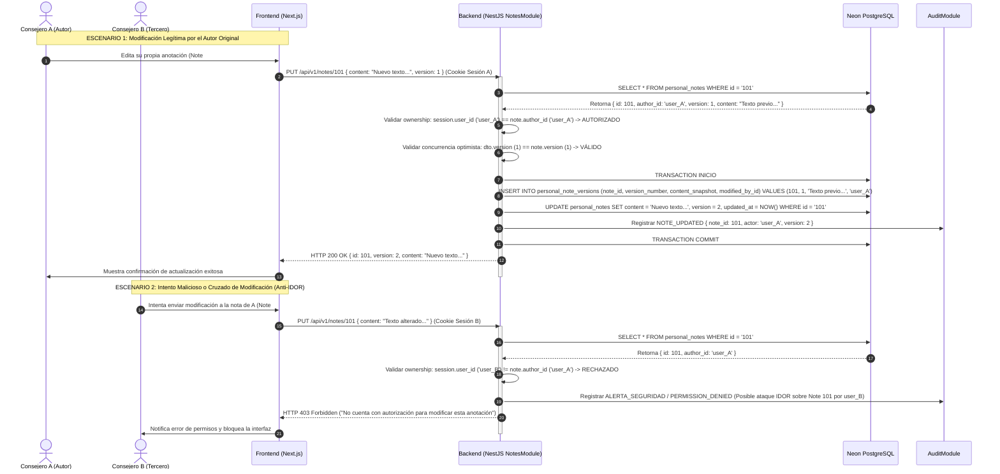
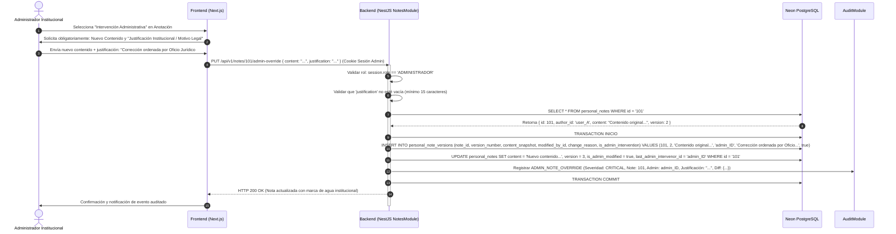
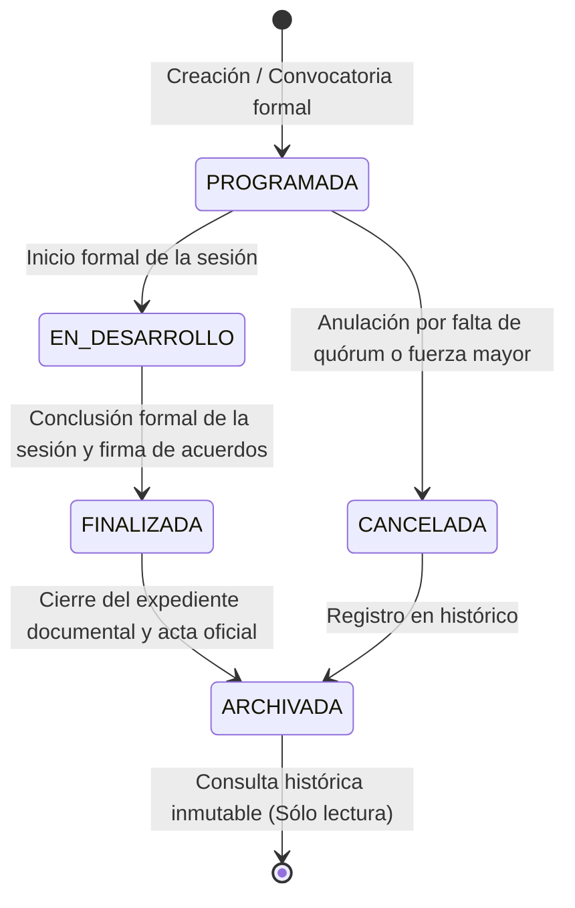
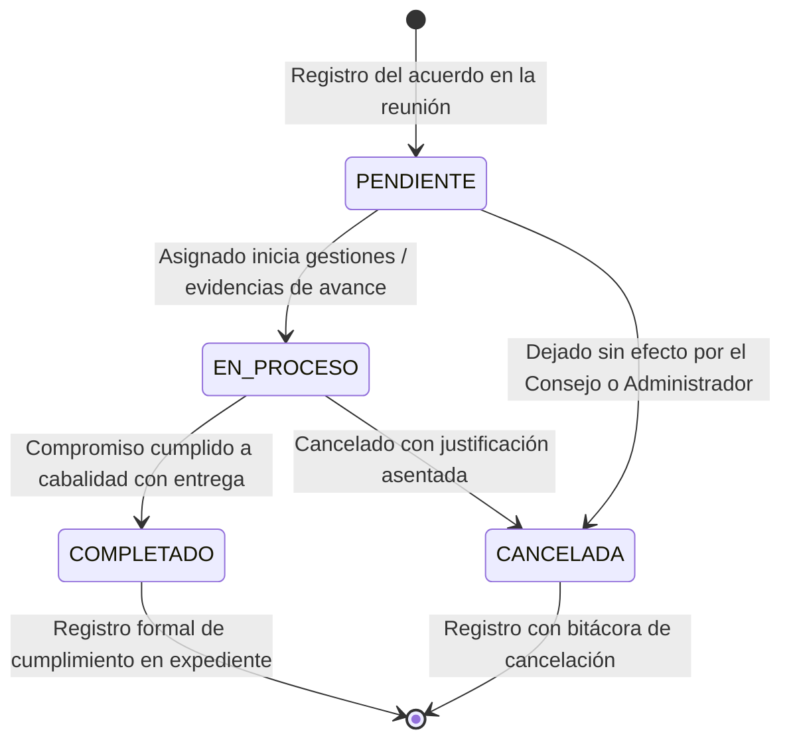
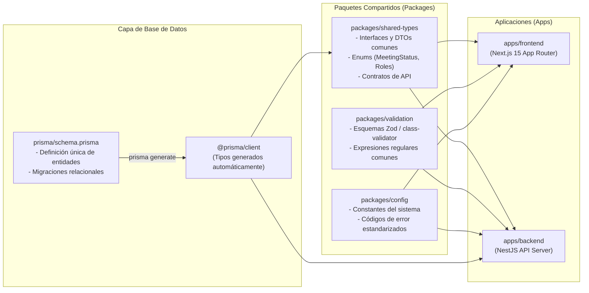

# DOCUMENTO 05: DIAGRAMAS DE ARQUITECTURA Y SECUENCIA
## Sistema Privado de Gestión Institucional (MexAgenda)
**Fase:** 0 — Análisis, Planificación y Especificación Técnica  
**Versión:** 1.0.0  
**Fecha:** Noviembre 2026  
**Estado:** Para Revisión y Aprobación  

---

## 1. DIAGRAMA DE ARQUITECTURA GENERAL Y TOPOLOGÍA

El siguiente diagrama detalla la interacción entre los clientes, las capas de borde (*edge*), el servidor de frontend Next.js, el API backend en NestJS y los servicios de persistencia en Neon PostgreSQL y almacenamiento S3.

```mermaid
flowchart TD
    subgraph CLIENT_TIER["Capa de Clientes Institucionales"]
        UserBrowser["Navegador Usuario / Consejero<br/>(Escritorio / Tablet / Móvil)"]
        AdminBrowser["Navegador Administrador<br/>(Consola de Control)"]
    end

    subgraph EDGE_SECURITY["Capa de Seguridad de Borde (Edge / WAF / CDN)"]
        WAF["WAF & Reverse Proxy (Cloudflare / NGINX)<br/>- Terminación TLS 1.3 / HSTS<br/>- Mitigación DDoS / Rate Limiting IP<br/>- CDN para activos estáticos"]
    end

    subgraph FRONTEND_TIER["Capa de Frontend (Next.js App Router)"]
        NextServer["Servidor Web Next.js (Node.js)<br/>- Server Components (SSR)<br/>- Middleware de Sesión y Redirección<br/>- BFF Proxy a API"]
    end

    subgraph BACKEND_TIER["Capa de Aplicación y Dominio (NestJS REST API)"]
        NestApp["Servidor Backend NestJS"]
        Guards["Guardias de Seguridad<br/>- AuthGuard (Cookie / Session)<br/>- RolesGuard & PermissionsGuard<br/>- RateLimitGuard"]
        Modules["Módulos de Negocio<br/>- AuthModule (Argon2id, TOTP)<br/>- UsersModule & RolesModule<br/>- MeetingsModule<br/>- NotesModule (Soberanía y Versionado)<br/>- AgreementsModule<br/>- AttachmentsModule<br/>- AuditModule (Inmutable)"]
        AuditInterceptor["Interceptor de Auditoría Global<br/>(Captura síncrona de eventos y diffs)"]
    end

    subgraph PERSISTENCE_TIER["Capa de Persistencia y Almacenamiento"]
        NeonPooler["Neon Connection Pooler (PgBouncer)"]
        PostgresDB[("Neon PostgreSQL Serverless<br/>- Tablas de Negocio<br/>- Control de Concurrencia Optimista<br/>- Triggers de Protección Audit")]
        S3Storage[("Almacenamiento de Objetos S3 Privado<br/>- Cifrado en Reposo (AES-256)<br/>- URLs Pre-firmadas efímeras<br/>- Cero Acceso Público")]
    end

    UserBrowser -->|HTTPS / TLS 1.3| WAF
    AdminBrowser -->|HTTPS / TLS 1.3| WAF
    WAF -->|Rutas de Interfaz / Static| NextServer
    WAF -->|Rutas de API REST /api/v1| NestApp
    NextServer -->|Proxy API interno / Fetch con Cookie| NestApp

    NestApp --> Guards
    Guards --> Modules
    Modules --> AuditInterceptor
    Modules -->|Prisma Client (Pooling)| NeonPooler
    NeonPooler --> PostgresDB
    AuditInterceptor -->|Persistencia Síncrona| PostgresDB
    Modules -->|AWS SDK v3 (Pre-signed URLs / Metadatos)| S3Storage
    UserBrowser -.->|Upload directo PUT con URL pre-firmada| S3Storage
    UserBrowser -.->|Download directo GET con URL pre-firmada| S3Storage
```

---

## 2. FLUJO DE AUTENTICACIÓN, RETO MFA Y CREACIÓN DE SESIÓN

Secuencia paso a paso que describe la validación de credenciales con Argon2id, el desafío TOTP obligatorio y la emisión de cookies seguras con registro en `user_sessions`.

```mermaid
sequenceDiagram
    autonumber
    actor U as Usuario Institucional
    participant FE as Frontend (Next.js)
    participant BE as Backend (NestJS AuthModule)
    participant DB as Neon PostgreSQL
    participant AUD as AuditModule

    U->>FE: Ingresa correo y contraseña
    FE->>BE: POST /api/v1/auth/login { email, password }
    
    activate BE
    BE->>DB: SELECT * FROM users WHERE email = :email
    DB-->>BE: Retorna registro (o null)

    alt Usuario no existe o cuenta inactiva / bloqueada
        BE->>AUD: Registrar LOGIN_FAILED (Motivo genérico)
        BE-->>FE: HTTP 401 Unauthorized ("Credenciales no válidas")
    else Credenciales válidas
        BE->>BE: Verificar hash con Argon2id.verify(user.password_hash, password)
        alt Contraseña incorrecta
            BE->>DB: Incrementar login_attempts para usuario e IP
            BE->>AUD: Registrar LOGIN_FAILED
            BE-->>FE: HTTP 401 Unauthorized ("Credenciales no válidas")
        else Contraseña correcta
            BE->>DB: SELECT * FROM user_mfa WHERE user_id = :userId AND is_enabled = true
            DB-->>BE: Retorna configuración MFA
            
            alt MFA configurado y activo
                BE->>BE: Generar token temporal efímero (MFA_CHALLENGE_TOKEN, TTL: 5 min)
                BE-->>FE: HTTP 200 OK { mfa_required: true, mfa_token: "..." }
                FE->>U: Desplegar pantalla de Desafío TOTP (código de 6 dígitos)
                
                U->>FE: Ingresa código TOTP de Google/Microsoft Authenticator
                FE->>BE: POST /api/v1/auth/mfa/verify { mfa_token, totp_code }
                
                BE->>BE: Desencriptar secreto MFA (AES-256-GCM) y validar TOTP (ventana +-1)
                alt Código TOTP incorrecto
                    BE->>AUD: Registrar MFA_CHALLENGE_FAILED
                    BE-->>FE: HTTP 401 Unauthorized ("Código de verificación incorrecto")
                else Código TOTP válido
                    BE->>DB: INSERT INTO user_sessions (user_id, token_hash, ip, expires_at)
                    BE->>AUD: Registrar LOGIN_SUCCESS (Con MFA exitoso)
                    BE-->>FE: HTTP 200 OK + Set-Cookie: __Host-mexagenda_session=...; HttpOnly; Secure; SameSite=Strict
                    FE->>U: Redirigir al Dashboard principal
                end
            else MFA no enrolado (Primer ingreso)
                BE-->>FE: HTTP 200 OK { mfa_enrollment_required: true }
                FE->>U: Forzar pantalla de enrolamiento con Código QR y Backup Codes
            end
        end
    end
    deactivate BE
```

---

## 3. GESTIÓN DE ANOTACIONES INDIVIDUALES (SOBERANÍA Y CONTROL ANTI-IDOR)

Demostración del control de soberanía: el Consejero A actualiza su nota exitosamente con versionado automático, mientras que un intento del Consejero B de modificar la nota de A es bloqueado tajantemente por el backend.



---

## 4. INTERVENCIÓN ADMINISTRATIVA EXTRAORDINARIA CON TRAZABILIDAD

Flujo especial en el que un Administrador interviene sobre una nota ajena, obligando a ingresar una justificación institucional, archivando el texto original y generando una alerta de auditoría crítica.



---

## 5. CICLO DE VIDA DE UNA REUNIÓN (DIAGRAMA DE ESTADOS)



---

## 6. CICLO DE VIDA DE UN ACUERDO INSTITUCIONAL (DIAGRAMA DE ESTADOS)



---

## 7. DEPENDENCIAS INTERNAS EN EL MONOREPO



