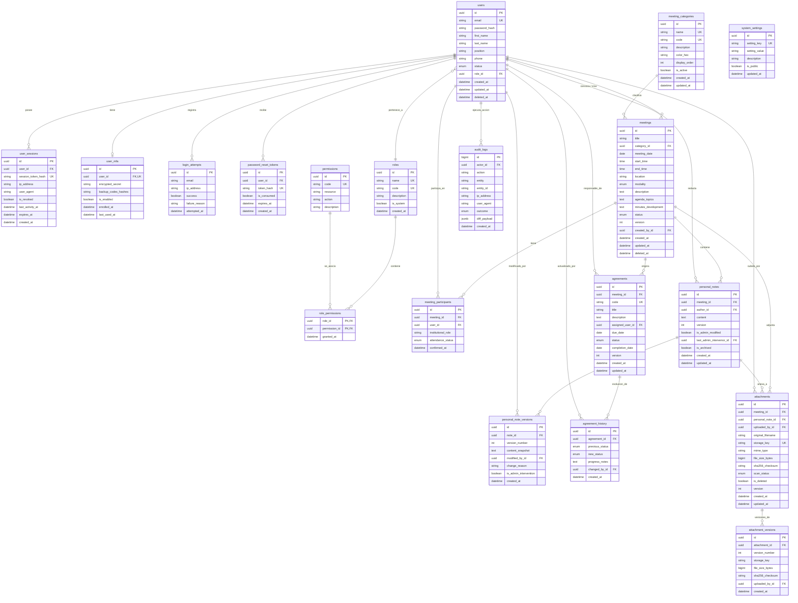

# DOCUMENTO 06: MODELO ENTIDAD-RELACIÓN Y ESQUEMA RELACIONAL
## Sistema Privado de Gestión Institucional (MexAgenda)
**Fase:** 0 — Análisis, Planificación y Especificación Técnica  
**Versión:** 1.0.0  
**Fecha:** Noviembre 2026  
**Estado:** Para Revisión y Aprobación  

---

## 1. INTRODUCCIÓN

Este documento define la estructura de datos relacional normalizada (en Tercera Forma Normal - 3NF) para el sistema **MexAgenda**, alojado en **Neon PostgreSQL**. 

El diseño prioriza:
- Integridad referencial estricta y llaves foráneas indexadas.
- Inmutabilidad de trazabilidad histórica mediante entidades de versionado (`personal_note_versions`, `agreement_history`, `attachment_versions`).
- Prevención de pérdida de datos mediante borrado lógico (*soft delete*) y reglas `ON DELETE RESTRICT` en entidades primarias.
- Control de concurrencia optimista mediante columnas enteras `version` en entidades de edición colaborativa.

---

## 2. DIAGRAMA ENTIDAD-RELACIÓN (MERMAID ERD)



---

## 3. ESQUEMA DE REFERENCIA PRISMA (DRAFT DE ARQUITECTURA)

El siguiente bloque modela en sintaxis de Prisma (`schema.prisma`) las 19 tablas principales para su implementación estricta durante la Fase 1.

```prisma
datasource db {
  provider = "postgresql"
  url      = env("DATABASE_URL")
}

generator client {
  provider = "prisma-client-js"
}

// -------------------------------------------------------------
// ENUMS DE NEGOCIO
// -------------------------------------------------------------

enum UserStatus {
  ACTIVO
  INACTIVO
  BLOQUEADO
  PENDIENTE_ACTIVACION
}

enum MeetingModality {
  PRESENCIAL
  VIRTUAL
  HIBRIDA
}

enum MeetingStatus {
  PROGRAMADA
  EN_DESARROLLO
  FINALIZADA
  CANCELADA
  ARCHIVADA
}

enum AttendanceStatus {
  CONVOCADO
  CONFIRMADO
  ASISTIO
  FALTA_JUSTIFICADA
  FALTA_INJUSTIFICADA
}

enum AgreementStatus {
  PENDIENTE
  EN_PROCESO
  COMPLETADO
  CANCELADO
}

enum FileScanStatus {
  PENDIENTE_REVISION
  LIMPIO
  INFECTADO
  ERROR_ESCANEO
}

enum AuditOutcome {
  SUCCESS
  FAILURE
  DENIED
}

// -------------------------------------------------------------
// CONTROL DE ACCESO, SEGURIDAD Y USUARIOS (MOD-01, MOD-02)
// -------------------------------------------------------------

model Role {
  id          String   @id @default(uuid()) @db.Uuid
  name        String   @unique @db.VarChar(50)
  code        String   @unique @db.VarChar(30)
  description String?  @db.VarChar(255)
  isSystem    Boolean  @default(false) @map("is_system")
  createdAt   DateTime @default(now()) @map("created_at")

  users       User[]
  permissions RolePermission[]

  @@map("roles")
}

model Permission {
  id          String   @id @default(uuid()) @db.Uuid
  code        String   @unique @db.VarChar(80)
  resource    String   @db.VarChar(50)
  action      String   @db.VarChar(30)
  description String?  @db.VarChar(255)

  roles       RolePermission[]

  @@map("permissions")
}

model RolePermission {
  roleId       String     @map("role_id") @db.Uuid
  permissionId String     @map("permission_id") @db.Uuid
  grantedAt    DateTime   @default(now()) @map("granted_at")

  role         Role       @relation(fields: [roleId], references: [id], onDelete: Cascade)
  permission   Permission @relation(fields: [permissionId], references: [id], onDelete: Cascade)

  @@id([roleId, permissionId])
  @@map("role_permissions")
}

model User {
  id            String     @id @default(uuid()) @db.Uuid
  email         String     @unique @db.VarChar(255)
  passwordHash  String     @map("password_hash") @db.VarChar(255)
  firstName     String     @map("first_name") @db.VarChar(100)
  lastName      String     @map("last_name") @db.VarChar(100)
  position      String     @db.VarChar(120)
  phone         String?    @db.VarChar(30)
  status        UserStatus @default(PENDIENTE_ACTIVACION)
  roleId        String     @map("role_id") @db.Uuid
  createdAt     DateTime   @default(now()) @map("created_at")
  updatedAt     DateTime   @updatedAt @map("updated_at")
  deletedAt     DateTime?  @map("deleted_at")

  role          Role       @relation(fields: [roleId], references: [id], onDelete: Restrict)
  sessions      UserSession[]
  mfa           UserMfa?
  resetTokens   PasswordResetToken[]
  meetingsCreated Meeting[] @relation("MeetingCreator")
  participations MeetingParticipant[]
  notes         PersonalNote[] @relation("NoteAuthor")
  noteVersionsEdited PersonalNoteVersion[] @relation("VersionEditor")
  adminInterventions PersonalNote[] @relation("AdminIntervenor")
  agreementsAssigned Agreement[] @relation("AgreementAssignee")
  agreementHistoryEntries AgreementHistory[] @relation("AgreementChanger")
  attachmentsUploaded Attachment[] @relation("AttachmentUploader")
  attachmentVersionsUploaded AttachmentVersion[] @relation("AttachmentVersionUploader")
  auditActions  AuditLog[] @relation("AuditActor")

  @@index([status])
  @@index([roleId])
  @@map("users")
}

model UserSession {
  id               String   @id @default(uuid()) @db.Uuid
  userId           String   @map("user_id") @db.Uuid
  sessionTokenHash String   @unique @map("session_token_hash") @db.VarChar(128)
  ipAddress        String   @map("ip_address") @db.VarChar(45)
  userAgent        String   @map("user_agent") @db.VarChar(300)
  isRevoked        Boolean  @default(false) @map("is_revoked")
  lastActivityAt   DateTime @default(now()) @map("last_activity_at")
  expiresAt        DateTime @map("expires_at")
  createdAt        DateTime @default(now()) @map("created_at")

  user             User     @relation(fields: [userId], references: [id], onDelete: Cascade)

  @@index([userId, isRevoked])
  @@index([expiresAt])
  @@map("user_sessions")
}

model UserMfa {
  id                 String   @id @default(uuid()) @db.Uuid
  userId             String   @unique @map("user_id") @db.Uuid
  encryptedSecret    String   @map("encrypted_secret") @db.Text
  backupCodesHashes  String   @map("backup_codes_hashes") @db.Text // JSON string de hashes
  isEnabled          Boolean  @default(false) @map("is_enabled")
  enrolledAt         DateTime? @map("enrolled_at")
  lastUsedAt         DateTime? @map("last_used_at")

  user               User     @relation(fields: [userId], references: [id], onDelete: Cascade)

  @@map("user_mfa")
}

model LoginAttempt {
  id            String   @id @default(uuid()) @db.Uuid
  email         String   @db.VarChar(255)
  ipAddress     String   @map("ip_address") @db.VarChar(45)
  success       Boolean  @default(false)
  failureReason String?  @map("failure_reason") @db.VarChar(100)
  attemptedAt   DateTime @default(now()) @map("attempted_at")

  @@index([email, attemptedAt])
  @@index([ipAddress, attemptedAt])
  @@map("login_attempts")
}

model PasswordResetToken {
  id         String   @id @default(uuid()) @db.Uuid
  userId     String   @map("user_id") @db.Uuid
  tokenHash  String   @unique @map("token_hash") @db.VarChar(128)
  isConsumed Boolean  @default(false) @map("is_consumed")
  expiresAt  DateTime @map("expires_at")
  createdAt  DateTime @default(now()) @map("created_at")

  user       User     @relation(fields: [userId], references: [id], onDelete: Cascade)

  @@index([tokenHash, isConsumed])
  @@map("password_reset_tokens")
}

// -------------------------------------------------------------
// CLASIFICACIONES Y REUNIONES (MOD-03, MOD-04)
// -------------------------------------------------------------

model MeetingCategory {
  id           String    @id @default(uuid()) @db.Uuid
  name         String    @unique @db.VarChar(100)
  code         String    @unique @db.VarChar(30)
  description  String?   @db.VarChar(255)
  colorHex     String    @default("#0F172A") @map("color_hex") @db.VarChar(7)
  displayOrder Int       @default(0) @map("display_order")
  isActive     Boolean   @default(true) @map("is_active")
  createdAt    DateTime  @default(now()) @map("created_at")
  updatedAt    DateTime  @updatedAt @map("updated_at")

  meetings     Meeting[]

  @@index([isActive, displayOrder])
  @@map("meeting_categories")
}

model Meeting {
  id                 String          @id @default(uuid()) @db.Uuid
  title              String          @db.VarChar(250)
  categoryId         String          @map("category_id") @db.Uuid
  meetingDate        DateTime        @map("meeting_date") @db.Date
  startTime          DateTime        @map("start_time") @db.Time(0)
  endTime            DateTime        @map("end_time") @db.Time(0)
  location           String          @db.VarChar(255)
  modality           MeetingModality @default(PRESENCIAL)
  description        String?         @db.Text
  agendaTopics       String?         @map("agenda_topics") @db.Text
  minutesDevelopment String?         @map("minutes_development") @db.Text
  status             MeetingStatus   @default(PROGRAMADA)
  version            Int             @default(1)
  createdById        String          @map("created_by_id") @db.Uuid
  createdAt          DateTime        @default(now()) @map("created_at")
  updatedAt          DateTime        @updatedAt @map("updated_at")
  deletedAt          DateTime?       @map("deleted_at")

  category           MeetingCategory @relation(fields: [categoryId], references: [id], onDelete: Restrict)
  creator            User            @relation("MeetingCreator", fields: [createdById], references: [id], onDelete: Restrict)
  participants       MeetingParticipant[]
  notes              PersonalNote[]
  agreements         Agreement[]
  attachments        Attachment[]

  @@index([meetingDate, status])
  @@index([categoryId])
  @@index([createdById])
  @@map("meetings")
}

model MeetingParticipant {
  id                String           @id @default(uuid()) @db.Uuid
  meetingId         String           @map("meeting_id") @db.Uuid
  userId            String           @map("user_id") @db.Uuid
  institutionalRole String           @default("Vocal") @map("institutional_role") @db.VarChar(80)
  attendanceStatus  AttendanceStatus @default(CONVOCADO) @map("attendance_status")
  confirmedAt       DateTime?        @map("confirmed_at")

  meeting           Meeting          @relation(fields: [meetingId], references: [id], onDelete: Cascade)
  user              User             @relation(fields: [userId], references: [id], onDelete: Restrict)

  @@unique([meetingId, userId])
  @@map("meeting_participants")
}

// -------------------------------------------------------------
// ANOTACIONES INDIVIDUALES Y SOBERANÍA (MOD-05)
// -------------------------------------------------------------

model PersonalNote {
  id                    String   @id @default(uuid()) @db.Uuid
  meetingId             String   @map("meeting_id") @db.Uuid
  authorId              String   @map("author_id") @db.Uuid
  content               String   @db.Text
  version               Int      @default(1)
  isAdminModified       Boolean  @default(false) @map("is_admin_modified")
  lastAdminIntervenorId String?  @map("last_admin_intervenor_id") @db.Uuid
  isArchived            Boolean  @default(false) @map("is_archived")
  createdAt             DateTime @default(now()) @map("created_at")
  updatedAt             DateTime @updatedAt @map("updated_at")

  meeting               Meeting  @relation(fields: [meetingId], references: [id], onDelete: Restrict)
  author                User     @relation("NoteAuthor", fields: [authorId], references: [id], onDelete: Restrict)
  lastAdminIntervenor   User?    @relation("AdminIntervenor", fields: [lastAdminIntervenorId], references: [id], onDelete: SetNull)
  versions              PersonalNoteVersion[]
  attachments           Attachment[]

  @@index([meetingId, authorId])
  @@index([authorId])
  @@map("personal_notes")
}

model PersonalNoteVersion {
  id                  String   @id @default(uuid()) @db.Uuid
  noteId              String   @map("note_id") @db.Uuid
  versionNumber       Int      @map("version_number")
  contentSnapshot     String   @map("content_snapshot") @db.Text
  modifiedById        String   @map("modified_by_id") @db.Uuid
  changeReason        String?  @map("change_reason") @db.VarChar(255)
  isAdminIntervention Boolean  @default(false) @map("is_admin_intervention")
  createdAt           DateTime @default(now()) @map("created_at")

  note                PersonalNote @relation(fields: [noteId], references: [id], onDelete: Cascade)
  editor              User         @relation("VersionEditor", fields: [modifiedById], references: [id], onDelete: Restrict)

  @@unique([noteId, versionNumber])
  @@index([noteId])
  @@map("personal_note_versions")
}

// -------------------------------------------------------------
// ACUERDOS Y COMPROMISOS (MOD-07)
// -------------------------------------------------------------

model Agreement {
  id             String          @id @default(uuid()) @db.Uuid
  meetingId      String          @map("meeting_id") @db.Uuid
  code           String          @unique @db.VarChar(50) // ej. ACU-2026-001
  title          String          @db.VarChar(250)
  description    String          @db.Text
  assignedUserId String          @map("assigned_user_id") @db.Uuid
  dueDate        DateTime        @map("due_date") @db.Date
  status         AgreementStatus @default(PENDIENTE)
  completionDate DateTime?       @map("completion_date") @db.Date
  version        Int             @default(1)
  createdAt      DateTime        @default(now()) @map("created_at")
  updatedAt      DateTime        @updatedAt @map("updated_at")

  meeting        Meeting         @relation(fields: [meetingId], references: [id], onDelete: Restrict)
  assignedUser   User            @relation("AgreementAssignee", fields: [assignedUserId], references: [id], onDelete: Restrict)
  history        AgreementHistory[]

  @@index([meetingId])
  @@index([assignedUserId, status])
  @@index([dueDate, status])
  @@map("agreements")
}

model AgreementHistory {
  id             String          @id @default(uuid()) @db.Uuid
  agreementId    String          @map("agreement_id") @db.Uuid
  previousStatus AgreementStatus @map("previous_status")
  newStatus      AgreementStatus @map("new_status")
  progressNotes  String?         @map("progress_notes") @db.Text
  changedById    String          @map("changed_by_id") @db.Uuid
  createdAt      DateTime        @default(now()) @map("created_at")

  agreement      Agreement       @relation(fields: [agreementId], references: [id], onDelete: Cascade)
  changer        User            @relation("AgreementChanger", fields: [changedById], references: [id], onDelete: Restrict)

  @@index([agreementId])
  @@map("agreement_history")
}

// -------------------------------------------------------------
// GESTIÓN DOCUMENTAL (MOD-06)
// -------------------------------------------------------------

model Attachment {
  id               String         @id @default(uuid()) @db.Uuid
  meetingId        String?        @map("meeting_id") @db.Uuid
  personalNoteId   String?        @map("personal_note_id") @db.Uuid
  uploadedById     String         @map("uploaded_by_id") @db.Uuid
  originalFilename String         @map("original_filename") @db.VarChar(255)
  storageKey       String         @unique @map("storage_key") @db.VarChar(255)
  mimeType         String         @map("mime_type") @db.VarChar(100)
  fileSizeBytes    BigInt         @map("file_size_bytes")
  sha256Checksum   String         @map("sha256_checksum") @db.VarChar(64)
  scanStatus       FileScanStatus @default(PENDIENTE_REVISION) @map("scan_status")
  isDeleted        Boolean        @default(false) @map("is_deleted")
  version          Int            @default(1)
  createdAt        DateTime       @default(now()) @map("created_at")
  updatedAt        DateTime       @updatedAt @map("updated_at")

  meeting          Meeting?       @relation(fields: [meetingId], references: [id], onDelete: Restrict)
  personalNote     PersonalNote?  @relation(fields: [personalNoteId], references: [id], onDelete: Restrict)
  uploader         User           @relation("AttachmentUploader", fields: [uploadedById], references: [id], onDelete: Restrict)
  versions         AttachmentVersion[]

  @@index([meetingId, isDeleted])
  @@index([personalNoteId, isDeleted])
  @@map("attachments")
}

model AttachmentVersion {
  id             String     @id @default(uuid()) @db.Uuid
  attachmentId   String     @map("attachment_id") @db.Uuid
  versionNumber  Int        @map("version_number")
  storageKey     String     @map("storage_key") @db.VarChar(255)
  fileSizeBytes  BigInt     @map("file_size_bytes")
  sha256Checksum String     @map("sha256_checksum") @db.VarChar(64)
  uploadedById   String     @map("uploaded_by_id") @db.Uuid
  createdAt      DateTime   @default(now()) @map("created_at")

  attachment     Attachment @relation(fields: [attachmentId], references: [id], onDelete: Cascade)
  uploader       User       @relation("AttachmentVersionUploader", fields: [uploadedById], references: [id], onDelete: Restrict)

  @@unique([attachmentId, versionNumber])
  @@map("attachment_versions")
}

// -------------------------------------------------------------
// AUDITORÍA Y TRAZABILIDAD (MOD-09)
// -------------------------------------------------------------

model AuditLog {
  id          BigInt       @id @default(autoincrement())
  actorId     String?      @map("actor_id") @db.Uuid
  action      String       @db.VarChar(80)
  entity      String       @db.VarChar(60)
  entityId    String       @map("entity_id") @db.VarChar(80)
  ipAddress   String       @map("ip_address") @db.VarChar(45)
  userAgent   String       @map("user_agent") @db.VarChar(300)
  outcome     AuditOutcome @default(SUCCESS)
  diffPayload Json?        @map("diff_payload")
  createdAt   DateTime     @default(now()) @map("created_at")

  actor       User?        @relation("AuditActor", fields: [actorId], references: [id], onDelete: SetNull)

  @@index([createdAt])
  @@index([actorId, createdAt])
  @@index([entity, entityId])
  @@map("audit_logs")
}

// -------------------------------------------------------------
// CONFIGURACIÓN GLOBAL DEL SISTEMA
// -------------------------------------------------------------

model SystemSetting {
  id           String   @id @default(uuid()) @db.Uuid
  settingKey   String   @unique @map("setting_key") @db.VarChar(80)
  settingValue String   @map("setting_value") @db.Text
  description  String?  @db.VarChar(255)
  isPublic     Boolean  @default(false) @map("is_public")
  updatedAt    DateTime @updatedAt @map("updated_at")

  @@map("system_settings")
}
```

