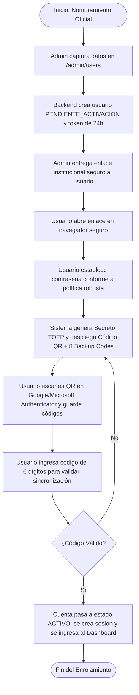
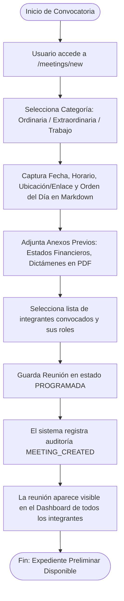
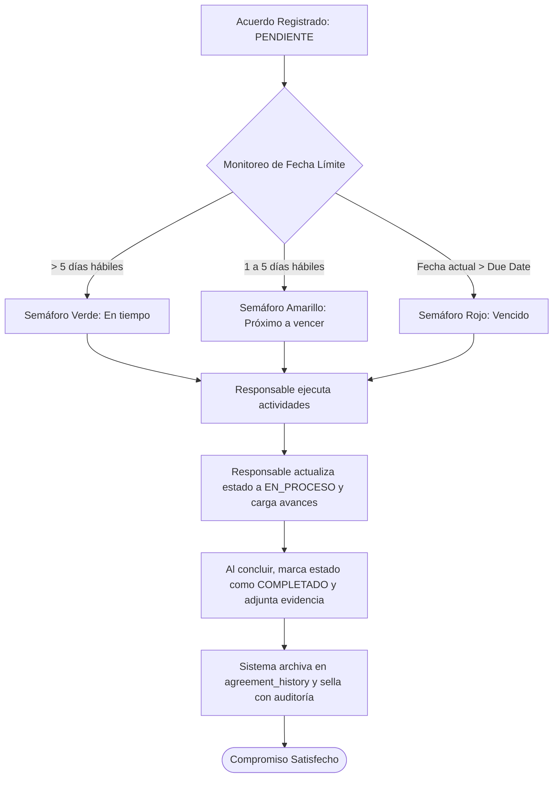

# DOCUMENTO 10: FLUJOS OPERATIVOS Y DE NEGOCIO
## Sistema Privado de Gestión Institucional (MexAgenda)
**Fase:** 0 — Análisis, Planificación y Especificación Técnica  
**Versión:** 1.0.0  
**Fecha:** Noviembre 2026  
**Estado:** Para Revisión y Aprobación  

---

## 1. INTRODUCCIÓN

Este documento describe los flujos operativos integrales que definen la interacción cotidiana de los consejeros, directivos y administradores con la plataforma. Cada flujo detalla los actores intervinientes, disparadores, pasos secuenciales, puntos de control de seguridad y gestión de excepciones.

---

## 2. CATÁLOGO DE FLUJOS OPERATIVOS CRÍTICOS

```
+-----------------------------------------------------------------------------------+
|                        MAPA DE FLUJOS OPERATIVOS DEL SISTEMA                      |
+-----------------------------------------------------------------------------------+
| FLUJO 1: Aprovisionamiento de Usuario y Enrolamiento MFA Obligatorio              |
| FLUJO 2: Convocatoria, Agenda y Preparación de una Sesión Institucional           |
| FLUJO 3: Deliberación en Vivo: Notas Concurrentes y Consulta entre Pares          |
| FLUJO 4: Formalización de Acuerdos y Clausura de Sesión                           |
| FLUJO 5: Seguimiento y Cumplimiento de Compromisos con Alertas Semafóricas        |
| FLUJO 6: Intervención Administrativa Extraordinaria con Sello de Auditoría        |
| FLUJO 7: Protocolo de Suspensión Inmediata de Cuenta y Purga de Sesiones          |
+-----------------------------------------------------------------------------------+
```

---

### FLUJO 1: APROVISIONAMIENTO DE USUARIO Y PRIMER ACCESO CON MFA OBLIGATORIO

- **Actores:** Administrador Institucional, Nuevo Integrante (Consejero).
- **Disparador:** Nombramiento oficial de un nuevo miembro en el Consejo o directiva.



- **Puntos de Control de Seguridad:**
  1. El enlace de bienvenida caduca a las 24 horas y es de un solo uso.
  2. No se permite omitir el enrolamiento MFA. El acceso a cualquier módulo de negocio está estrictamente condicionado a la activación de TOTP.
  3. Los 8 códigos de recuperación se muestran una única vez; el usuario debe confirmar su descarga o copia antes de avanzar.

---

### FLUJO 2: CONVOCATORIA Y PREPARACIÓN DE UNA SESIÓN INSTITUCIONAL

- **Actores:** Usuario Convocante (o Administrador), Consejeros Invitados.
- **Disparador:** Necesidad estatutaria o reglamentaria de sesionar.



- **Puntos de Control de Negocio:**
  - Validación de horario: `start_time < end_time`.
  - Validación de anexos: Los archivos son verificados por tamaño (< 25 MB) y Magic Bytes antes de quedar asociados.

---

### FLUJO 3: DELIBERACIÓN EN VIVO: NOTAS CONCURRENTES Y CONSULTA ENTRE PARES

- **Actores:** Consejero A, Consejero B, Consejero C (simultáneamente).
- **Disparador:** La sesión pasa a estado `EN_DESARROLLO`.

```
[Consejero A] ───────────────> Redacta nota: "Observación al punto 2..."
                                       │ (Se guarda con author_id = Consejero A)
                                       ▼
                             [Base de Datos PostgreSQL]
                                       ▲
[Consejero B] ───────────────> Consulta la sesión y visualiza en tiempo real
                               la nota del Consejero A (Lectura Abierta).
                                       │
                                       ▼
                               Intenta hacer clic en editar nota de A ──> BOTÓN DESHABILITADO.
                               Si fuerza petición HTTP ───────────────> RECHAZO HTTP 403.
                                       │
                                       ▼
                               Redacta su propia nota: "Respaldo la postura del Consejero A..."
```

- **Reglas del Flujo:**
  1. **Edición Soberana:** Cada usuario edita sus propias palabras en cualquier momento de la sesión. Cada guardado incrementa `version` y archiva el snapshot en `personal_note_versions`.
  2. **Colaboración Transparente:** La vista de reunión presenta un muro cronológico organizado por participante donde todos leen las deliberaciones de todos.

---

### FLUJO 4: FORMALIZACIÓN DE ACUERDOS Y CLAUSURA DE SESIÓN

- **Actores:** Presidente de la Sesión, Secretario Técnico, Administrador.
- **Disparador:** Desahogo de todos los puntos del orden del día.

1. **Síntesis del Desarrollo:** El redactor consolida la minuta en el campo `minutes_development`.
2. **Alta de Acuerdos:** Por cada punto aprobado que requiera ejecución futura, se invoca `POST /meetings/:id/agreements`:
   - Se genera el folio institucional (ej. `ACU-2026-042-01`).
   - Se designa al funcionario institucional responsable (`assigned_user_id`).
   - Se estipula la fecha límite fatal (`due_date`).
3. **Cierre Formal:** La reunión cambia de estado a `FINALIZADA`.
4. **Archivo Documental:** Los anexos definitivos (acta firmada o aprobada) se incorporan con validación de integridad criptográfica (SHA-256).

---

### FLUJO 5: SEGUIMIENTO Y CUMPLIMIENTO DE COMPROMISOS

- **Actores:** Funcionario Asignado, Administrador Institucional.
- **Disparador:** Monitoreo periódico del tablero institucional de acuerdos.



---

### FLUJO 6: INTERVENCIÓN ADMINISTRATIVA EXTRAORDINARIA SOBRE NOTAS

- **Actores:** Administrador Institucional, Consejero Afectado.
- **Disparador:** Detección de error material grave, información legalmente prohibida (ej. revelación no autorizada de datos personales sensibles) o mandato de autoridad judicial.

1. El Administrador ubica la anotación en el expediente de la reunión y selecciona la acción restringida **Intervención Administrativa**.
2. La plataforma despliega una ventana de advertencia de seguridad indicando que:
   - La acción quedará marcada con sello indeleble en la nota visible para todos.
   - El texto original no se perderá; se archivará en la tabla de versiones.
   - La intervención se registrará como evento crítico en la auditoría.
3. El Administrador debe capturar:
   - El texto sustituto corregido.
   - La **Justificación Institucional Obligatoria** (mínimo 15 caracteres; se valida formalmente).
4. El backend ejecuta la operación en una transacción atómica:
   - Guarda el snapshot original en `personal_note_versions` con el flag `is_admin_intervention = true`.
   - Modifica `personal_notes` con `is_admin_modified = true` y `last_admin_intervenor_id = session.user_id`.
   - Registra el evento `ADMIN_NOTE_OVERRIDE` en `audit_logs` con el diff completo.
5. En la interfaz gráfica de la reunión, la anotación muestra una insignia visual:  
   *`[Intervenida administrativamente por Secretaría Técnica el 15/Nov/2026 - Motivo: Mandato OIC-44]`*.

---

### FLUJO 7: PROTOCOLO DE SUSPENSIÓN INMEDIATA DE CUENTA

- **Actores:** Administrador Institucional.
- **Disparador:** Separación del cargo de un consejero, baja de personal o sospecha de compromiso de credenciales.

1. El Administrador accede al módulo `/admin/users` y localiza al integrante.
2. Selecciona la opción **Desactivar Cuenta**.
3. El sistema solicita motivo de la suspensión.
4. Al confirmar, el backend ejecuta en una sola transacción:
   - Actualiza `users.status = 'INACTIVO'`.
   - Ejecuta `UPDATE user_sessions SET is_revoked = true WHERE user_id = :userId`.
   - Registra en `audit_logs` el evento `USER_DEACTIVATED` y `SESSIONS_REVOKED`.
5. **Efecto Inmediato:** En la siguiente petición HTTP del usuario suspendido (máximo en los siguientes segundos), el guardia `SessionAuthGuard` detecta `is_revoked = true` o `status = 'INACTIVO'`, destruye la cookie y expulsa al usuario al login con mensaje genérico.
6. Todos los registros históricos, anotaciones y reuniones creadas previamente por el usuario permanecen 100% intactos para preservar la memoria institucional.

