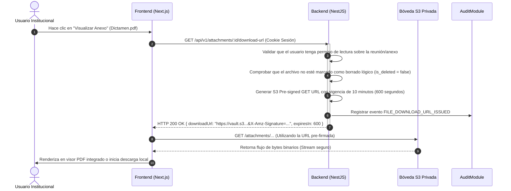

# DOCUMENTO 13: DISEÑO DE ALMACENAMIENTO DOCUMENTAL Y EXPEDIENTE DIGITAL
## Sistema Privado de Gestión Institucional (MexAgenda)
**Fase:** 0 — Análisis, Planificación y Especificación Técnica  
**Versión:** 1.0.0  
**Fecha:** Noviembre 2026  
**Estado:** Para Revisión y Aprobación  

---

## 1. INTRODUCCIÓN Y ARQUITECTURA DE ALMACENAMIENTO

La gestión documental en **MexAgenda** custodia los activos de mayor valor institucional: dictámenes de auditoría, balances financieros, contratos, actas firmadas y presentaciones ejecutivas. 

Para garantizar máxima escalabilidad, rendimiento y ciberseguridad, **ningún archivo binario se almacena dentro de la base de datos PostgreSQL** ni en el sistema de archivos efímero de los contenedores de aplicación. Se implementa un esquema de **Bóveda Documental Desacoplada en Almacenamiento de Objetos S3 Privado**, mediado por validación criptográfica y URLs pre-firmadas de corta vigencia.

```
+-----------------------------------------------------------------------------------+
|               ARQUITECTURA DE LA BÓVEDA DOCUMENTAL PRIVADA                        |
+-----------------------------------------------------------------------------------+
| [Navegador Web] ──> Solicita Intent de Carga ──> [Backend NestJS]                |
|       │                                                  │ Valida permisos y cuota|
|       │ <── Retorna S3 Pre-signed PUT URL (5 min) <──────┘                        |
|       │                                                                           |
|       ▼ (Upload directo por HTTPS)                                                |
| [Bucket S3 Privado: mexagenda-vault] (Cifrado AES-256 en Reposo)                  |
|       ▲                                                                           |
|       │ (Confirmación de subida)                                                  |
| [Backend NestJS] ──> Lee primeros bytes de S3 ──> [Pipeline Validador Magic Bytes]|
|                      ──> Calcula SHA-256 Digest ──> Persiste Metadatos en Postgres|
+-----------------------------------------------------------------------------------+
```

---

## 2. FORMATOS PERMITIDOS Y VALIDACIÓN DE FIRMAS BINARIAS (MAGIC BYTES)

Para neutralizar vectores de ataque por extensión falsa (ej. un ejecutable `.exe` renombrado a `.pdf`), el sistema no confía en la extensión del archivo ni en el header `Content-Type` enviado por el navegador. Se inspeccionan los bytes iniciales del archivo (*Magic Bytes / File Signatures*).

| Formato | Extensión | Tipo MIME Oficial | Firma Binaria Requerida (Magic Bytes) | Offset |
|---|:---:|---|---|:---:|
| **Adobe PDF** | `.pdf` | `application/pdf` | `25 50 44 46` (`%PDF-`) | 0 |
| **Microsoft Word** | `.docx` | `application/vnd.openxmlformats-officedocument.wordprocessingml.document` | `50 4B 03 04` (`PK..` archivo ZIP OpenXML) | 0 |
| **Microsoft Excel** | `.xlsx` | `application/vnd.openxmlformats-officedocument.spreadsheetml.sheet` | `50 4B 03 04` (`PK..` archivo ZIP OpenXML) | 0 |
| **Imagen PNG** | `.png` | `image/png` | `89 50 4E 47 0D 0A 1A 0A` (`.PNG....`) | 0 |
| **Imagen JPEG** | `.jpg`, `.jpeg` | `image/jpeg` | `FF D8 FF` | 0 |

### Algoritmo de Verificación de Firma Binaria (NestJS):
```typescript
import { Injectable, BadRequestException } from '@nestjs/common';

@Injectable()
export class FileSignatureValidator {
  private static readonly SIGNATURES: Record<string, number[][]> = {
    'application/pdf': [[0x25, 0x50, 0x44, 0x46]], // %PDF
    'image/png': [[0x89, 0x50, 0x4e, 0x47, 0x0d, 0x0a, 0x1a, 0x0a]],
    'image/jpeg': [[0xff, 0xd8, 0xff]],
    'application/vnd.openxmlformats-officedocument.wordprocessingml.document': [
      [0x50, 0x4b, 0x03, 0x04],
    ],
    'application/vnd.openxmlformats-officedocument.spreadsheetml.sheet': [
      [0x50, 0x4b, 0x03, 0x04],
    ],
  };

  public validate(buffer: Buffer, declaredMimeType: string): boolean {
    const validSignatures = FileSignatureValidator.SIGNATURES[declaredMimeType];
    if (!validSignatures) {
      throw new BadRequestException(`Tipo de archivo no admitido: ${declaredMimeType}`);
    }

    const matches = validSignatures.some((signature) =>
      signature.every((byte, index) => buffer[index] === byte)
    );

    if (!matches) {
      throw new BadRequestException(
        'Inconsistencia de Seguridad: El contenido binario del archivo no coincide con el formato declarado.'
      );
    }
    return true;
  }
}
```

---

## 3. POLÍTICA DE SEGURIDAD Y CONFIGURACIÓN DEL BUCKET S3

1. **Bloqueo Total de Acceso Público (*Block Public Access: ON*):**
   - `BlockPublicAcls: true`
   - `IgnorePublicAcls: true`
   - `BlockPublicPolicy: true`
   - `RestrictPublicBuckets: true`
   Cualquier intento de acceso web directo sin credenciales devuelve un error HTTP 403 Access Denied.
2. **Cifrado del Lado del Servidor (*Server-Side Encryption*):**
   - Cifrado forzado con **AES-256** (`aws:kms` o `AES256`).
3. **Estructura Segura de Claves de Almacenamiento:**
   Los archivos se almacenan bajo nombres pseudoaleatorios no derivables:
   `mexagenda-vault/attachments/<tenant_id>/<year>/<uuid-v4>/<sha256-hash>`
   El nombre original aportado por el usuario (`Dictamen_Final.pdf`) se preserva únicamente como metadato en PostgreSQL, eliminando riesgos de Directory Traversal o inyecciones en el sistema de archivos.
4. **Límite de Tamaño:** 25 Megabytes (MB) por anexo. Archivos de mayor tamaño son rechazados en la emisión del intent.

---

## 4. FLUJO SEGURO DE DESCARGA Y VISUALIZACIÓN



---

## 5. VERSIONADO DOCUMENTAL Y BORRADO LÓGICO

1. **Versionado de Archivos:** Si un consejero o administrador carga una fe de erratas o versión corregida de un anexo, el registro en la tabla `attachments` incrementa su columna `version`, conservando en la tabla `attachment_versions` la referencia al archivo binario anterior en S3. Esto garantiza que nunca se pierda el expediente que fue deliberado en una fecha previa.
2. **Borrado Lógico (*Soft Delete*):** La eliminación de un anexo no borra físicamente el objeto en S3 de forma instantánea. Se marca `is_deleted = true`.
3. **Purga Definitiva Programada:** Un procedimiento administrativo trimestral, ejecutado bajo supervisión del Administrador y formalmente auditado, procesa los registros con más de 90 días en borrado lógico y ejecuta la eliminación física en S3 (*Hard Delete*) para liberar almacenamiento no necesario.

