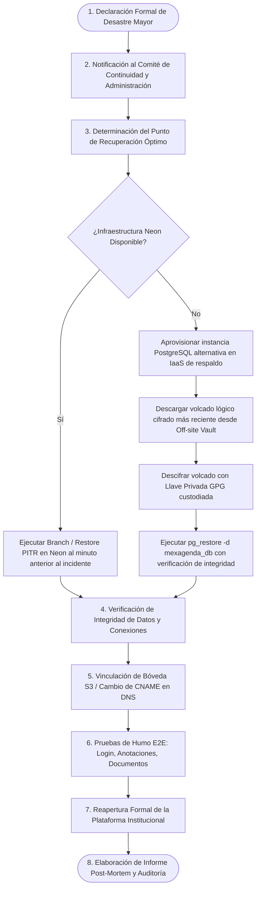

# DOCUMENTO 14: PLAN DE RESPALDOS Y RECUPERACIÓN ANTE DESASTRES (DRP / BCP)
## Sistema Privado de Gestión Institucional (MexAgenda)
**Fase:** 0 — Análisis, Planificación y Especificación Técnica  
**Versión:** 1.0.0  
**Fecha:** Noviembre 2026  
**Estado:** Para Revisión y Aprobación  

---

## 1. OBJETIVOS DE CONTINUIDAD DE NEGOCIO (RPO / RTO)

La pérdida de información institucional deliberada en comités de gobierno o actas de consejo conlleva repercusiones fiduciarias, legales y operativas irreversibles. Por ello, la estrategia de respaldo y recuperación ante desastres (*Disaster Recovery Plan - DRP*) no se fía exclusivamente de las funciones automáticas de un único proveedor en la nube; implementa un plan integral, redundante y verificable.

```
+-----------------------------------------------------------------------------------+
|               MÉTRICAS CLAVE DE RECUPERACIÓN INSTITUCIONAL                        |
+-----------------------------------------------------------------------------------+
| RPO (Recovery Point Objective):  < 1 HORA (Pérdida máxima admisible de datos)     |
|   * En condiciones normales: < 5 minutos gracias al streaming WAL continuo de Neon|
|                                                                                   |
| RTO (Recovery Time Objective):   < 4 HORAS (Tiempo máximo para volver a operar)   |
|   * Despliegue de infraestructura alterna y restauración completa de BD y S3      |
+-----------------------------------------------------------------------------------+
```

---

## 2. ESTRATEGIA MULTINIVEL DE RESPALDOS

```
+-----------------------------------------------------------------------------------+
|                   ARQUITECTURA DE RESPALDO EN 3 NIVELES (3-2-1)                   |
+-----------------------------------------------------------------------------------+
| 1. PRIMARIO: Neon PostgreSQL PITR (Point-in-Time Recovery continuo, retención 7d) |
| 2. SECUNDARIO: Volcados Lógicos Diarios (pg_dump) Cifrados con GPG/AES-256        |
| 3. TERCIARIO (OFF-SITE): Réplica de Volcados en Región Aislada / Proveedor Alterno|
| + S3 REPLICATION: Versionado de Objetos y Replicación Cruzada de Bóveda Documental|
+-----------------------------------------------------------------------------------+
```

### 2.1. Nivel 1: Respaldo Continuo en Neon PostgreSQL (PITR)
- **Mecanismo:** La arquitectura desacoplada de cómputo y almacenamiento de Neon realiza un streaming continuo del *Write-Ahead Log (WAL)*.
- **Capacidad:** Permite restaurar la base de datos a cualquier segundo específico del tiempo (*Point-in-Time Recovery*) dentro de una ventana móvil de **7 días**.
- **Caso de uso:** Recuperación rápida ante error humano involuntario (ej. ejecución de una consulta indebida) o corrupción lógica inmediata.

### 2.2. Nivel 2: Volcados Lógicos Cifrados Diarios (Cold Backups)
- **Frecuencia:** Todos los días a las **02:00 horas (Tiempo del Centro de México)**.
- **Herramienta:** Tarea automatizada programada que ejecuta `pg_dump` en formato personalizado comprimido (`-Fc`).
- **Cifrado Obligatorio:** El archivo de volcado se cifra de forma inmediata antes de salir de la memoria mediante **GPG / AES-256** utilizando una llave asimétrica cuyo par privado se resguarda fuera de la nube.
- **Retención:**
  - Respaldos diarios: se retienen durante **30 días**.
  - Respaldos semanales (domingos): se retienen durante **12 semanas**.
  - Respaldos mensuales (día 1 del mes): se retienen durante **36 meses**.

### 2.3. Nivel 3: Resguardo Fuera del Proveedor Principal (*Off-Site Vault*)
- Los respaldos diarios cifrados se transfieren automáticamente a un almacenamiento de objetos en una región geográfica o proveedor distinto (ej. si Neon y AWS operan en Virginia `us-east-1`, la copia fría se aloja en Cloudflare R2 o AWS Ohio `us-east-2`).

### 2.4. Respaldo de la Bóveda Documental (Archivos S3)
- El bucket `mexagenda-vault` cuenta con **Versionado de Objetos Activado (*S3 Object Versioning: ENABLED*)**, impidiendo que la sobreescritura o eliminación accidental destruya los binarios.
- Política de replicación entre regiones (*Cross-Region Replication - CRR*) hacia un bucket secundario de contingencia.

---

## 3. GUÍA DE RECUPERACIÓN ANTE DESASTRES (RUNBOOK OPERATIVO)

En caso de indisponibilidad catastrófica del centro de datos principal o compromiso mayor de la infraestructura, se ejecutará el siguiente procedimiento de emergencia:



---

## 4. PROTOCOLO DE SIMULACROS Y PRUEBAS PERIÓDICAS DE RESTAURACIÓN

> **Un respaldo no probado no es un respaldo.**

Para garantizar que el plan de recuperación sea viable y operativo en cualquier momento:
1. **Simulacro Mensual de Restauración en Seco (*Restore Drill*):**
   - El primer lunes de cada mes, de forma automatizada en un ambiente aislado de Staging, el sistema toma el volcado lógico de la noche anterior, lo descifra, lo levanta en una base de datos temporal, ejecuta las pruebas automatizadas de integridad de Prisma y valida que las 19 tablas principales contengan registros consistentes.
2. **Bitácora de Simulacros:**
   - Todo ejercicio de restauración genera un certificado técnico de resultado que se archiva en la documentación de cumplimiento del Administrador.
3. **Auditoría de Llaves de Cifrado:**
   - Revisión semestral del protocolo de custodia de llaves de descifrado resguardadas en caja de seguridad institucional física o módulo HSM.

