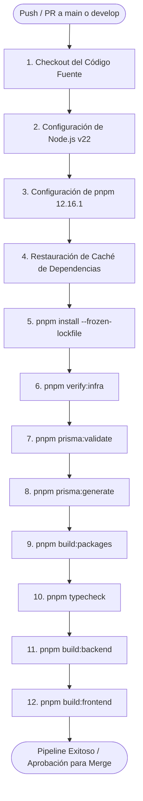

# DOCUMENTO 10: INTEGRACIÓN CONTINUA (CI/CD) CON GITHUB ACTIONS
## Sistema Privado de Gestión Institucional (MexAgenda)
**Fase:** 1 — Infraestructura, Monorepo, Neon PostgreSQL y Prisma  
**Versión:** 1.0.0  
**Fecha:** Noviembre 2026  
**Estado:** Implementado / En Verificación  

---

## 1. VISIÓN DEL PIPELINE DE INTEGRACIÓN CONTINUA

La gobernanza técnica de **MexAgenda** exige que ninguna línea de código llegue a ramas principales (`main`, `develop`) sin superar un pipeline automatizado, reproducible e inmutable en **GitHub Actions** (`.github/workflows/ci.yml`).

### Principios de CI/CD Institucionales:
1. **Cero Secretos en Pipelines:** No se inyectan contraseñas reales ni tokens de producción en el código de los flujos de trabajo.
2. **Reproducibilidad Garantizada:** Instalación mediante `pnpm install --frozen-lockfile` con almacenamiento de caché de dependencias en GitHub Actions para tiempos de ejecución inferiores a 3 minutos.
3. **Verificación Escalonada:** Las pruebas se ejecutan de menor a mayor costo computacional (validación estática -> esquemas -> tipos -> compilación de paquetes -> compilación de aplicaciones).
4. **Despliegue Protegido:** El pipeline de Fase 1 **no despliega automáticamente a producción**, requiriendo aprobación formal y compuertas de calidad.

---

## 2. ETAPAS DEL FLUJO DE TRABAJO (`ci.yml`)



---

## 3. CONFIGURACIÓN COMPLETA DEL WORKFLOW

```yaml
name: Integración Continua (CI) — MexAgenda

on:
  push:
    branches: [ main, develop ]
  pull_request:
    branches: [ main, develop ]

concurrency:
  group: ${{ github.workflow }}-${{ github.ref }}
  cancel-in-progress: true

jobs:
  validate-and-build:
    name: Verificación, Validación y Compilación
    runs-on: ubuntu-latest

    steps:
      - name: 1. Descarga del Código Fuente
        uses: actions/checkout@v4

      - name: 2. Configurar Entorno de Node.js
        uses: actions/setup-node@v4
        with:
          node-version: 22
          registry-url: 'https://registry.npmjs.org'

      - name: 3. Instalar pnpm
        uses: pnpm/action-setup@v4
        with:
          version: 12.16.1
          run_install: false

      - name: 4. Obtener Directorio de Caché de pnpm
        shell: bash
        run: |
          echo "STORE_PATH=$(pnpm store path --silent)" >> $GITHUB_ENV

      - name: 5. Restaurar Caché de Dependencias
        uses: actions/cache@v4
        with:
          path: ${{ env.STORE_PATH }}
          key: ${{ runner.os }}-pnpm-store-${{ hashFiles('**/pnpm-lock.yaml') }}
          restore-keys: |
            ${{ runner.os }}-pnpm-store-

      - name: 6. Instalar Dependencias del Monorepo
        run: pnpm install --frozen-lockfile

      - name: 7. Verificación de Infraestructura Estática
        run: pnpm verify:infra

      - name: 8. Validación del Esquema de Prisma (19 Entidades)
        run: pnpm prisma:validate

      - name: 9. Generación del Cliente Tipado de Prisma
        run: pnpm prisma:generate

      - name: 10. Compilación de Paquetes Compartidos
        run: pnpm build:packages

      - name: 11. Comprobación de Tipos Estricta de TypeScript
        run: pnpm typecheck

      - name: 12. Compilación del Backend (NestJS)
        run: pnpm build:backend
        env:
          NODE_ENV: test
          PORT: 4000
          FRONTEND_URL: http://localhost:3000
          BACKEND_URL: http://localhost:4000

      - name: 13. Compilación del Frontend (Next.js)
        run: pnpm build:frontend
        env:
          NEXT_PUBLIC_BACKEND_URL: http://localhost:4000
```
