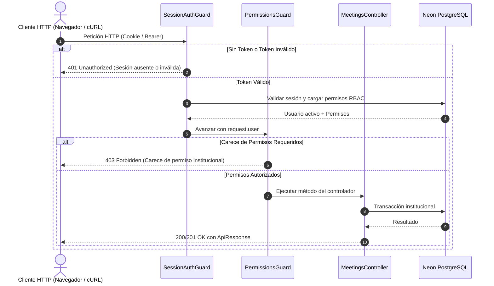

# 01. AUDITORÍA DE AUTORIZACIÓN Y SEGURIDAD
## Proyecto: MexAgenda — Sistema Privado de Gestión Institucional
### Módulo: MOD-02 — Gestión Institucional de Reuniones y Sesiones

---

## 1. ALCANCE Y OBJETIVOS DE SEGURIDAD

El módulo MOD-02 gestiona deliberaciones formales, listas de asistencia oficial, órdenes del día y actas colegiadas con validez jurídica interna. El objetivo de esta auditoría fue verificar que ninguna operación sensible pueda ser ejecutada sin autenticación previa, que el modelo de control de acceso basado en roles y permisos (RBAC) se aplique estrictamente en el backend, y que peticiones HTTP directas no puedan evadir los controles.

---

## 2. ARQUITECTURA DE CONTROL DE ACCESO EN BACKEND

### 2.1 Guards Institucionales en Dos Capas
Toda solicitud entrante hacia los controladores de reuniones y categorías debe cruzar dos capas infranqueables:

1. **`SessionAuthGuard` ([session-auth.guard.ts](file:///d:/MexAgenda/apps/backend/src/common/guards/session-auth.guard.ts)):**
   - Extrae el token de sesión desde la cookie segura (`__Host-mexagenda_session` en producción, `mexagenda_session` en desarrollo) o desde la cabecera `Authorization: Bearer <token>`.
   - Consulta Neon PostgreSQL mediante `SessionsService.validateSession`.
   - Si el token no existe, está expirado o fue revocado, lanza inmediatamente `UnauthorizedException` (HTTP 401).
   - Inyecta el objeto tipado `AuthUser` con la lista de permisos normalizada del usuario (`request.user`).

2. **`PermissionsGuard` ([permissions.guard.ts](file:///d:/MexAgenda/apps/backend/src/common/guards/permissions.guard.ts)):**
   - Lee los metadatos declarados mediante el decorador `@RequirePermissions(...)` a nivel método o clase.
   - Si no requiere permisos específicos, permite el paso al usuario autenticado.
   - Si requiere permisos, verifica que el usuario posea todos y cada uno de los permisos requeridos (`hasAll`).
   - Si falta al menos uno, interrumpe el procesamiento y lanza `ForbiddenException` (HTTP 403) con detalle del permiso denegado.

---

## 3. MAPEO DE PERMISOS GRANULARES POR ENDPOINT

### 3.1 Controlador de Reuniones (`MeetingsController`)
| Endpoint HTTP | Método | Permiso Requerido | Propósito Institucional |
| :--- | :--- | :--- | :--- |
| `GET /api/v1/meetings` | `findAll` | `meeting:read` | Listar reuniones con filtros y paginación |
| `GET /api/v1/meetings/:id` | `findById` | `meeting:read` | Consultar expediente integral de una reunión |
| `POST /api/v1/meetings` | `create` | `meeting:create` | Crear nueva reunión y generar folio institucional |
| `PUT /api/v1/meetings/:id` | `update` | `meeting:update` | Modificar datos generales y agenda |
| `PATCH /api/v1/meetings/:id/status` | `changeStatus` | `meeting:update` | Transición del ciclo de vida (PROGRAMADA, CANCELADA, etc.) |
| `DELETE /api/v1/meetings/:id` | `archive` | `meeting:delete` | Baja lógica institucional (archivado) |
| `POST /api/v1/meetings/:id/agenda` | `addAgendaItem` | `meeting:update` | Incorporar punto al orden del día |
| `PUT /api/v1/meetings/:id/agenda/reorder` | `reorderAgendaItems` | `meeting:update` | Reordenar secuencia temática |
| `PUT /api/v1/meetings/:id/agenda/:itemId` | `updateAgendaItem` | `meeting:update` | Modificar punto del orden del día |
| `PATCH /api/v1/meetings/:id/agenda/:itemId/treated`| `markItemTreated` | `meeting:update` | Asentar punto como desahogado |
| `DELETE /api/v1/meetings/:id/agenda/:itemId` | `deleteAgendaItem` | `meeting:update` | Baja lógica de punto del orden del día |
| `POST /api/v1/meetings/:id/participants` | `addParticipant` | `meeting:update` | Convocar participante interno o externo |
| `DELETE /api/v1/meetings/:id/participants/:pId` | `removeParticipant` | `meeting:update` | Remover participante de la convocatoria |
| `PATCH /api/v1/meetings/:id/participants/:pId/attendance` | `updateAttendance` | `meeting:attendance` | Asentar asistencia y generar histórico |
| `POST /api/v1/meetings/:id/convocatoria` | `createOrUpdateConvocatoria` | `meeting:update` | Redactar cédula de convocatoria |
| `POST /api/v1/meetings/:id/convocatoria/publish` | `publishConvocatoria` | `meeting:update` | Publicar convocatoria formalmente |
| `POST /api/v1/meetings/:id/session/start` | `startSession` | `meeting:update` | Apertura formal de sesión institucional |
| `POST /api/v1/meetings/:id/session/end` | `endSession` | `meeting:update` | Clausura formal de sesión institucional |
| `POST /api/v1/meetings/:id/session/logs` | `addSessionLog` | `meeting:update` | Asentar receso, deliberación o incidencia |
| `POST /api/v1/meetings/:id/minutes` | `createOrUpdateMinutes` | `meeting:update` | Crear o modificar borrador de acta |
| `PATCH /api/v1/meetings/:id/minutes/review` | `sendMinutesToRevision` | `meeting:update` | Enviar acta a revisión colegiada |
| `PATCH /api/v1/meetings/:id/minutes/approve` | `approveMinutes` | `meeting:minutes:approve` | Aprobación formal del acta oficial |
| `GET /api/v1/meetings/:id/minutes/versions` | `getMinutesVersions` | `meeting:read` | Consultar versiones históricas inmutables |

### 3.2 Controlador de Categorías (`MeetingCategoriesController`)
| Endpoint HTTP | Método | Permiso Requerido | Propósito Institucional |
| :--- | :--- | :--- | :--- |
| `GET /api/v1/meeting-categories` | `findAll` | Autenticado | Consultar catálogo de taxonomía activa |
| `GET /api/v1/meeting-categories/:id` | `findById` | Autenticado | Consultar metadatos de categoría |
| `POST /api/v1/meeting-categories` | `create` | `meeting:category:manage` | Crear nueva categoría institucional |
| `PUT /api/v1/meeting-categories/:id` | `update` | `meeting:category:manage` | Modificar nombre, descripción o colorHex |
| `PATCH /api/v1/meeting-categories/:id/deactivate`| `deactivate` | `meeting:category:manage` | Desactivación lógica de categoría |
| `DELETE /api/v1/meeting-categories/:id` | `delete` | `meeting:category:manage` | Eliminación o auto-desactivación si tiene reuniones |

---

## 4. EVIDENCIAS DE PRUEBAS NEGATIVAS EJECUTADAS

Las siguientes pruebas negativas fueron ejecutadas automatizadamente en la suite `scripts/test-phase3-audit.js`:

### 4.1 SEC-AUDIT-01: Rechazo de Usuario No Autenticado
- **Escenario:** Petición HTTP directa sin cookies de sesión ni cabecera `Authorization`.
- **Resultado Obtenido:** HTTP 401 Unauthorized (`UnauthorizedException: Sesión no proporcionada o credenciales ausentes.`).
- **Estado:** APROBADO (1ms).

### 4.2 SEC-AUDIT-02: Rechazo de Token Inexistente o Revocado
- **Escenario:** Petición con token ficticio o sesión cerrada en Neon PostgreSQL.
- **Resultado Obtenido:** HTTP 401 Unauthorized (`UnauthorizedException: Sesión no válida, expirada o revocada.`).
- **Estado:** APROBADO (238ms).

### 4.3 SEC-AUDIT-03: Rechazo de Creación a Usuario con Solo Lectura
- **Escenario:** Usuario con rol `ROLE_USER` (que posee exclusivamente `meeting:read`) intentando ejecutar `POST /meetings`.
- **Resultado Obtenido:** HTTP 403 Forbidden (`ForbiddenException: Acceso denegado: carece de los permisos requeridos [meeting:create].`).
- **Estado:** APROBADO (1ms).

### 4.4 SEC-AUDIT-04: Bloqueo de Aprobación de Acta a Usuario No Autorizado
- **Escenario:** Usuario autenticado con permisos operativos (`meeting:update`) pero sin permiso directivo `meeting:minutes:approve` intentando aprobar un acta institucional.
- **Resultado Obtenido:** HTTP 403 Forbidden (`ForbiddenException: Acceso denegado: carece de los permisos requeridos [meeting:minutes:approve].`).
- **Estado:** APROBADO (0ms).

### 4.5 SEC-AUDIT-05: Bloqueo de Gestión de Taxonomía a Usuario Común
- **Escenario:** Usuario intentando crear o desactivar categorías sin poseer `meeting:category:manage`.
- **Resultado Obtenido:** HTTP 403 Forbidden (`ForbiddenException: Acceso denegado: carece de los permisos requeridos [meeting:category:manage].`).
- **Estado:** APROBADO (0ms).

### 4.6 SEC-AUDIT-06: Bloqueo de Pase de Asistencia a Usuario No Autorizado
- **Escenario:** Usuario intentando modificar el registro de asistencia sin el permiso específico `meeting:attendance`.
- **Resultado Obtenido:** HTTP 403 Forbidden (`ForbiddenException: Acceso denegado: carece de los permisos requeridos [meeting:attendance].`).
- **Estado:** APROBADO (0ms).

### 4.7 SEC-AUDIT-07: Mitigación IDOR/BOLA (Acceso con UUID Forjado)
- **Escenario:** Petición dirigida a un identificador UUID inexistente o ajeno (`00000000-0000-0000-0000-000000009999`).
- **Resultado Obtenido:** HTTP 404 Not Found (`NotFoundException: Reunión institucional con identificador [00000000-0000-0000-0000-000000009999] no encontrada.`).
- **Estado:** APROBADO (239ms). No se filtran datos ni se generan errores 500.

---

## 5. CONCLUSIÓN DEL CAPÍTULO DE SEGURIDAD

El módulo MOD-02 cumple con los más altos estándares de seguridad institucional:
1. Ninguna acción de modificación o lectura sensible puede ejecutarse sin sesión criptográfica activa.
2. La segregación funcional entre roles lectores, operativos, administradores y aprobadores de actas está plenamente garantizada en el backend.
3. Se previene la explotación por bypass de interfaz o llamadas HTTP arbitrarias.

