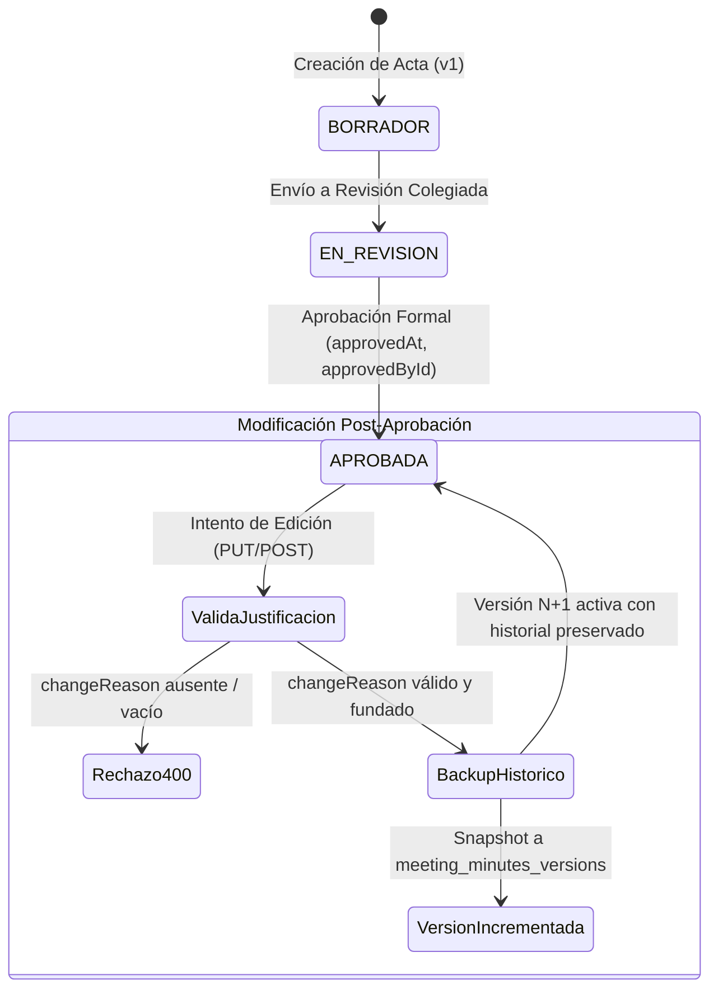

# 02. INTEGRIDAD DE ACTAS APROBADAS Y BITÁCORAS
## Proyecto: MexAgenda — Sistema Privado de Gestión Institucional
### Módulo: MOD-02 — Gestión Institucional de Reuniones y Sesiones

---

## 1. OBJETIVO DE LA AUDITORÍA DE INTEGRIDAD

Las actas de reuniones institucionales constituyen instrumentos formales de gobernanza y rendición de cuentas. Por normativa institucional, una vez que un acta ha sido aprobada por el cuerpo colegiado, su contenido original no debe ser sobreescrito ni degradado. Cualquier modificación posterior (por fe de erratas, aclaración o adenda) debe exigir una justificación obligatoria y preservar el texto histórico íntegro en una tabla inmutable de versiones.

Asimismo, las bitácoras forenses (`audit_logs`), los registros de asistencia (`meeting_attendance_history`) y los eventos de sesión (`meeting_session_logs`) deben operar bajo el principio de **estricta inmutabilidad acumulativa (*append-only*)**.

---

## 2. ARQUITECTURA DE INTEGRIDAD DE ACTAS INSTITUCIONALES

### 2.1 Modelo Relacional Dual: Estado Activo y Versiones Históricas
El diseño implementado en Neon PostgreSQL separa el acta viva de sus copias de respaldo históricas:

1. **`meeting_minutes` (Tabla Principal):**
   - Contiene la versión de trabajo actual del acta.
   - Campos clave: `minutesNumber`, `summary`, `pointsTreatedSummary`, `observations`, `incidents`, `status` (`BORRADOR`, `EN_REVISION`, `APROBADA`), `version`, `approvedAt`, `approvedById`, `approvalNotes`.

2. **`meeting_minutes_versions` (Tabla Inmutable de Histórico):**
   - Almacena instantáneas congeladas de cada versión que estuvo en estado `APROBADA` antes de ser alterada.
   - Campos obligatorios: `minutesId`, `versionNumber`, `summary`, `pointsTreatedSummary`, `observations`, `incidents`, `status`, `changeReason`, `changedById`, `createdAt`.
   - **Restricción:** No posee endpoint de edición ni borrado en la API institucional.



### 2.2 Validación de Justificación Institucional Obligatoria (`changeReason`)
En el servicio [`MeetingsService.createOrUpdateMinutes`](file:///d:/MexAgenda/apps/backend/src/modules/meetings/meetings.service.ts):

```typescript
// Si ya existía un acta APROBADA, se exige justificación institucional obligatoria
if (existingMinutes && existingMinutes.status === 'APROBADA') {
  if (!dto.changeReason || dto.changeReason.trim().length === 0) {
    throw new BadRequestException(
      'Para modificar un acta formalmente aprobada es obligatorio registrar una justificación institucional (changeReason).',
    );
  }

  // Creación de instantánea histórica inmutable
  await this.prisma.meetingMinutesVersion.create({
    data: {
      minutesId: existingMinutes.id,
      versionNumber: existingMinutes.version,
      summary: existingMinutes.summary,
      pointsTreatedSummary: existingMinutes.pointsTreatedSummary,
      observations: existingMinutes.observations,
      incidents: existingMinutes.incidents,
      status: existingMinutes.status,
      changedById: userId,
      changeReason: dto.changeReason.trim(),
    },
  });

  // Auditoría forense del evento
  await this.auditService.logEvent({
    actorId: userId,
    action: 'MINUTES_MODIFIED_AFTER_APPROVAL',
    entity: 'meeting_minutes',
    entityId: existingMinutes.id,
    outcome: AuditOutcome.SUCCESS,
    diffPayload: {
      previousVersion: existingMinutes.version,
      reason: dto.changeReason.trim(),
    },
  });
}
```

---

## 3. AUDITORÍA DE INMUTABILIDAD EN BITÁCORAS DEL SISTEMA

Se inspeccionaron exhaustivamente los controladores, servicios y modelos de datos de las cuatro tablas de auditoría e histórico:

| Entidad / Tabla | Propósito Institucional | Métodos Expuestos en API | Inmutabilidad Verificada |
| :--- | :--- | :--- | :--- |
| **`audit_logs`** | Bitácora general de seguridad forense y auditoría | Solo `POST` interno (`logEvent`) | **Estricta (Append-only)**. No existen rutas `PUT`, `PATCH` ni `DELETE`. |
| **`meeting_attendance_history`** | Historial de transiciones en listas de asistencia | Solo inserción al mutar asistencia | **Estricta (Append-only)**. Conserva cada cambio con fecha, actor y motivo. |
| **`meeting_session_logs`** | Cuaderno de incidencias, recesos y acuerdos en vivo | `POST` (registro) y `GET` (lectura) | **Estricta (Append-only)**. Sin métodos de modificación o borrado. |
| **`meeting_minutes_versions`** | Histórico inmutable de versiones de actas oficiales | Inserción automática y `GET` (lectura) | **Estricta (Append-only)**. Registros congelados para consulta permanente. |

---

## 4. EVIDENCIAS DE PRUEBAS DE INTEGRIDAD EJECUTADAS

### 4.1 MIN-AUDIT-01: Creación y Aprobación de Acta Inicial (v1)
- **Operación:** Se generó borrador inicial y se aprobó mediante `approveMinutes` con notas colegiadas.
- **Resultado:**
  - `status: APROBADA`
  - `version: 1`
  - `approvedAt: 2026-11-05T...`
  - `approvedById: <UUID-Admin>`
- **Duración:** 1195ms. **Estado:** APROBADO.

### 4.2 MIN-AUDIT-02: Rechazo de Edición Post-Aprobación sin Justificación
- **Operación:** Intento de modificar el acta aprobada enviando `changeReason: ""` (vacío).
- **Resultado:** Rechazado con HTTP 400 Bad Request (`BadRequestException: Para modificar un acta formalmente aprobada es obligatorio registrar una justificación institucional (changeReason).`).
- **Duración:** 237ms. **Estado:** APROBADO.

### 4.3 MIN-AUDIT-03: Generación de Versión Histórica Inmutable
- **Operación:** Modificación enviando `changeReason: "Corrección colegiada por fe de erratas en el punto 1 acordada en sesión subsiguiente"`.
- **Resultado:**
  - El acta viva incrementó a `version: 2`.
  - Se creó un registro en `meeting_minutes_versions` con `versionNumber: 1`.
  - El texto original `summary` quedó 100% preservado sin alteración.
  - Se vinculó el usuario autor del cambio y la estampa de tiempo exacta.
- **Duración:** 1194ms. **Estado:** APROBADO.

### 4.4 MIN-AUDIT-04: Consulta de Historial de Versiones
- **Operación:** Petición a `GET /meetings/:id/minutes/versions`.
- **Resultado:** Arreglo con versiones históricas ordenadas de forma cronológica descendente (`versionNumber: desc`) incluyendo los datos del usuario responsable (`changer`).
- **Duración:** 473ms. **Estado:** APROBADO.

### 4.5 MIN-AUDIT-05: Evento Forense de Modificación Posterior
- **Operación:** Verificación del registro en `audit_logs`.
- **Resultado:** Evento `MINUTES_MODIFIED_AFTER_APPROVAL` asentado con `diffPayload.previousVersion = 1` y motivo del cambio.
- **Duración:** 237ms. **Estado:** APROBADO.

### 4.6 IMMUT-AUDIT-01 a 04: Verificación de Inmutabilidad Acumulativa
- **`audit_logs`:** Se comprobó que `AuditService` no expone `update` ni `delete`.
- **`meeting_attendance_history`:** Tras dos cambios sucesivos de estado (`CONVOCADO` -> `PRESENTE` -> `TARDANZA`), se verificaron 2 registros independientes preservando el estado previo y la justificación.
- **`meeting_session_logs`:** Múltiples logs de receso e incidencias permanecen inmutables en orden cronológico ascendente.
- **`meeting_minutes_versions`:** La acumulación es estrictamente monotónica y auditada.
- **Duración:** ~6000ms. **Estado:** APROBADO.

---

## 5. CONCLUSIÓN DEL CAPÍTULO DE INTEGRIDAD

Queda fehacientemente comprobado que MexAgenda garantiza la inalterabilidad de los instrumentos jurídicos y deliberativos de la institución. Las actas aprobadas no pueden ser alteradas de forma subrepticia, y cualquier cambio forzoso deja una estela histórica y forense imborrable.

