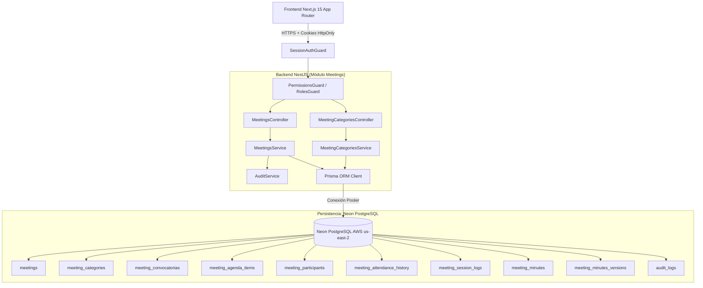
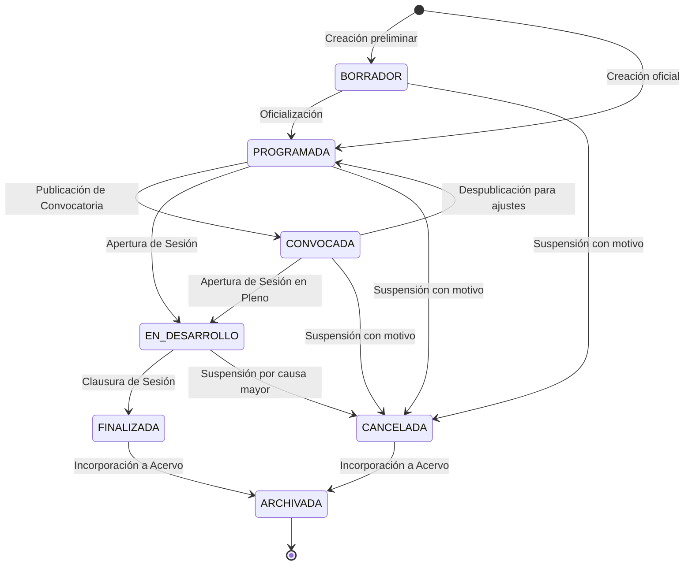

# 01 — Arquitectura del Módulo de Reuniones y Sesiones (MOD-02)

## 1. Visión General y Propósito Arquitectónico

El módulo **MOD-02: Gestión Institucional de Reuniones y Sesiones** articula el proceso colegiado de cuerpos directivos, comités y órganos de gobierno. La arquitectura técnica garantiza:

- **Soberanía y privacidad de datos:** Alojamiento exclusivo en Neon PostgreSQL con cifrado TLS 1.3 en tránsito y AES-256 en reposo.
- **Trazabilidad inmutable:** Cada mutación sensible (creación, cambio de horario, convocatoria, asistencia, apertura de sesión, acta) genera un registro inmutable en `audit_logs`.
- **Integridad y consistencia referencial:** Modelo relacional normalizado con llaves foráneas protegidas y reglas de negocio para impedir estados incoherentes.
- **Control de concurrencia optimista:** Campo `version` en la tabla `meetings` que incrementa en cada actualización para prevenir sobreescrituras concurrentes.

---

## 2. Diagrama de Arquitectura de Componentes

---

## 3. Máquina de Estados del Ciclo de Vida Colegiado

El ciclo de vida de una reunión en MexAgenda sigue una máquina de estados determinista gobernada por el método `validateStatusTransition`:

### Reglas de Transición
1. **Paso a `CONVOCADA`:** Se activa automáticamente al ejecutar `POST /meetings/:id/convocatoria/publish`.
2. **Paso a `EN_DESARROLLO`:** Se realiza mediante `POST /meetings/:id/session/start`, registrando `realStartTime` y emitiendo un evento `INICIO` en la bitácora.
3. **Paso a `FINALIZADA`:** Se realiza mediante `POST /meetings/:id/session/end`, registrando `realEndTime` y emitiendo un evento `CIERRE` en la bitácora.
4. **Paso a `CANCELADA`:** Requiere obligatoriamente un campo `reason` no vacío; este motivo se asienta en las observaciones de la sesión y en la bitácora forense de auditoría.
5. **Paso a `ARCHIVADA`:** Marca la sesión como preservada permanentemente en el archivo histórico institucional. No se permite ninguna mutación posterior.

---

## 4. Estructura Modular en Backend NestJS

El módulo fue estructurado en dos submódulos de alta cohesión:

1. **`MeetingCategoriesModule` (`src/modules/meeting-categories/`)**:
   - `meeting-categories.controller.ts`: Rutas para catálogo taxonómico (`/meeting-categories`).
   - `meeting-categories.service.ts`: CRUD con validación de unicidad de código/nombre y desactivación suave (`isActive = false`).
   - `dto/`: DTOs tipados y validados para creación y actualización de categorías.

2. **`MeetingsModule` (`src/modules/meetings/`)**:
   - `meetings.controller.ts`: Rutas operativas (`/meetings`, subrecursos de agenda, convocatoria, participantes, asistencia, sesiones y actas).
   - `meetings.service.ts`: Lógica de negocio colegiado, validaciones temporales, cálculo métrico de asistencia, emisión de bitácora y versionamiento de actas.
   - `dto/`: DTOs especializados (`CreateMeetingDto`, `UpdateMeetingDto`, `QueryMeetingsDto`, `ChangeMeetingStatusDto`, `agenda.dto.ts`, `participant.dto.ts`, `convocatoria.dto.ts`, `session-log.dto.ts`, `minutes.dto.ts`).

---

## 5. Integración en Frontend Next.js 15

La experiencia institucional se apoya en el App Router de Next.js con componentes optimizados para pantallas colegiadas y dispositivos móviles de consejeros:

- **`/meetings`:** Vista de catálogo con búsqueda en tiempo real, filtros por categoría, modalidad, estado y rango de fechas. Vista en tabla para ordenadores de escritorio y tarjetas interactivas para móviles.
- **`/meetings/calendar`:** Vista mensual interactiva de calendario colegiado, codificada con los colores institucionales de cada categoría.
- **`/meetings/new`:** Formulario guiado de captura con validación en cliente de horarios (`startTime < endTime`) y selección taxonómica.
- **`/meetings/[id]`:** Expediente colegiado unificado organizado en seis pestañas temáticas:
  1. *General y Horario:* Datos rectores, recinto, modalidad, autoridades y metadatos.
  2. *Convocatoria Oficial:* Cédula formal, estado de publicación y padrón de destinatarios.
  3. *Orden del Día:* Puntos secuenciales, responsables, tiempos y desahogo colegiado.
  4. *Participantes y Asistencia:* Pase de lista en vivo, justificaciones y cuadro de mando con métricas de quórum.
  5. *Desarrollo de Sesión:* Reloj de apertura/cierre real y bitácora cronológica inmutable de eventos.
  6. *Acta Institucional:* Redacción ejecutiva, desahogo, incidencias, flujo de aprobación y visualizador de versiones históricas (MIN-006).
- **`/meeting-categories`:** Panel de configuración taxonómica institucional con altas, bajas lógicas y selección de color hex.

