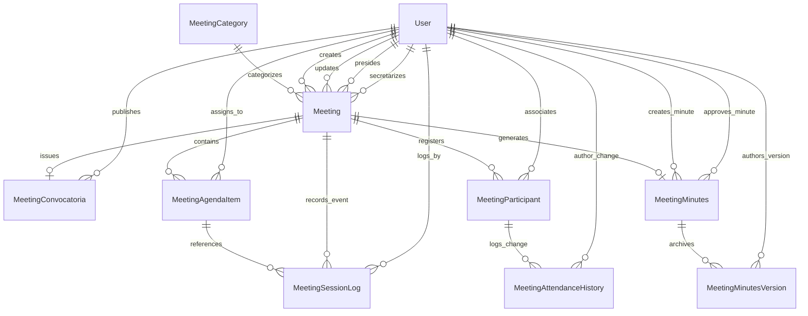

# 02 — Modelo de Datos Relacional de Fase 3 (Prisma & Neon PostgreSQL)

## 1. Visión General del Modelo de Persistencia

La Fase 3 extendió el esquema institucional en Neon PostgreSQL sin alterar los modelos de Fase 1 y Fase 2, incorporando 6 nuevas entidades relacionales y ampliando `Meeting` y `MeetingParticipant`.

La migración oficial `20261105044500_phase3_meetings_and_sessions` fue generada mediante Prisma y desplegada limpiamente sobre Neon PostgreSQL.

---

## 2. Diagrama Entidad-Relación (ER) de Fase 3



---

## 3. Especificación Detallada de Entidades

### 3.1. `Meeting` (Ampliación)
Representa la reunión institucional en su nivel directivo.
- `id` (UUID, PK): Identificador único global.
- `folio` (VARCHAR(50), UNIQUE): Código institucional secuencial (`ORD-2026-001`, `EXT-2026-002`).
- `title` (VARCHAR(250), NOT NULL): Asunto o título de la reunión.
- `categoryId` (UUID, FK -> `meeting_categories.id`, ON DELETE RESTRICT).
- `meetingDate` (DATE, NOT NULL): Fecha de celebración.
- `startTime` (TIME(0), NOT NULL): Hora programada de inicio.
- `endTime` (TIME(0), NOT NULL): Hora programada de conclusión.
- `realStartTime` (TIMESTAMPTZ, NULLABLE): Hora real de apertura formal de la sesión.
- `realEndTime` (TIMESTAMPTZ, NULLABLE): Hora real de clausura de la sesión.
- `location` (VARCHAR(255), NOT NULL): Recinto o sala física.
- `modality` (ENUM `MeetingModality`): `PRESENCIAL`, `VIRTUAL`, `HIBRIDA`.
- `virtualUrl` (VARCHAR(500), NULLABLE): Enlace seguro para videoconferencia.
- `timezone` (VARCHAR(60), DEFAULT 'America/Mexico_City'): Huso oficial.
- `description` (TEXT, NULLABLE): Antecedentes y justificación.
- `observations` (TEXT, NULLABLE): Notas institucionales y motivo de cancelación en su caso.
- `status` (ENUM `MeetingStatus`): `BORRADOR`, `PROGRAMADA`, `CONVOCADA`, `EN_DESARROLLO`, `FINALIZADA`, `CANCELADA`, `ARCHIVADA`.
- `version` (INT, DEFAULT 1): Contador de concurrencia optimista.
- `createdById` (UUID, FK -> `users.id`, ON DELETE RESTRICT).
- `updatedById` (UUID, FK -> `users.id`, NULLABLE, ON DELETE SET NULL).
- `presidedById` (UUID, FK -> `users.id`, NULLABLE, ON DELETE SET NULL): Autoridad que preside.
- `secretaryById` (UUID, FK -> `users.id`, NULLABLE, ON DELETE SET NULL): Secretario de actas.
- `deletedAt` (TIMESTAMPTZ, NULLABLE): Marca de borrado lógico institucional.

### 3.2. `MeetingConvocatoria` (Nueva Entidad)
Cédula oficial de citación a los miembros colegiados.
- `id` (UUID, PK).
- `meetingId` (UUID, UNIQUE, FK -> `meetings.id`, ON DELETE CASCADE).
- `convocatoriaNumber` (VARCHAR(60), UNIQUE): Número de oficio de convocatoria (`CONV-ORD-2026-001`).
- `issueDate` (TIMESTAMPTZ, DEFAULT NOW()): Fecha de expedición.
- `noticeText` (TEXT, NOT NULL): Cuerpo del oficio notificatorio.
- `isPublished` (BOOLEAN, DEFAULT FALSE): Bandera de publicación oficial.
- `publishedAt` (TIMESTAMPTZ, NULLABLE): Fecha y hora exacta de emisión.
- `publishedById` (UUID, FK -> `users.id`, NULLABLE, ON DELETE SET NULL).
- `recipients` (JSONB, NULLABLE): Captura instantánea (*snapshot*) de destinatarios al momento de publicar.
- `observations` (TEXT, NULLABLE).

### 3.3. `MeetingAgendaItem` (Nueva Entidad)
Puntos temáticos a desahogar en el orden del día.
- `id` (UUID, PK).
- `meetingId` (UUID, FK -> `meetings.id`, ON DELETE CASCADE).
- `orderIndex` (INT, NOT NULL): Número ordinal secuencial (1, 2, 3...).
- `title` (VARCHAR(250), NOT NULL): Asunto o título del punto.
- `description` (TEXT, NULLABLE).
- `responsibleName` (VARCHAR(150), NULLABLE): Nombre del expositor.
- `responsibleUserId` (UUID, FK -> `users.id`, NULLABLE, ON DELETE SET NULL).
- `estimatedMinutes` (INT, NULLABLE): Tiempo asignado en minutos.
- `itemType` (VARCHAR(50), DEFAULT 'ASUNTOS_ORDINARIOS').
- `status` (VARCHAR(30), DEFAULT 'PENDIENTE'): `PENDIENTE`, `EN_DISCUSION`, `TRATADO`, `POSPUESTO`.
- `isTreated` (BOOLEAN, DEFAULT FALSE): Indicador de desahogo.
- `treatedAt` (TIMESTAMPTZ, NULLABLE): Hora de conclusión del punto.
- `isDeleted` (BOOLEAN, DEFAULT FALSE): Baja lógica del punto en el orden del día.

### 3.4. `MeetingParticipant` (Ampliación)
Padrón de asistentes y convocados a la sesión.
- `id` (UUID, PK).
- `meetingId` (UUID, FK -> `meetings.id`, ON DELETE CASCADE).
- `userId` (UUID, NULLABLE, FK -> `users.id`, ON DELETE CASCADE): Nulo si es participante externo.
- `institutionalRole` (VARCHAR(80), DEFAULT 'Vocal'): Rol en la sesión.
- `participationCondition` (VARCHAR(50), DEFAULT 'TITULAR'): `TITULAR`, `SUPLENTE`, `INVITADO`.
- `attendanceStatus` (ENUM `AttendanceStatus`): `CONVOCADO`, `CONFIRMADO`, `PRESENTE`, `AUSENTE`, `JUSTIFICADO`, `TARDANZA`, `PARTICIPACION_REMOTA`.
- `isExternal` (BOOLEAN, DEFAULT FALSE): Identifica invitados ajenos a la plantilla.
- `externalName`, `externalEmail`, `externalOrganization` (VARCHAR, NULLABLE).
- `arrivalTime` (TIMESTAMPTZ, NULLABLE): Hora de pase de lista.
- `notes` (TEXT, NULLABLE).

### 3.5. `MeetingAttendanceHistory` (Nueva Entidad)
Trazabilidad inmutable de cambios de estado en la lista de asistencia.
- `id` (UUID, PK).
- `participantId` (UUID, FK -> `meeting_participants.id`, ON DELETE CASCADE).
- `previousStatus` (ENUM `AttendanceStatus`).
- `newStatus` (ENUM `AttendanceStatus`).
- `changedById` (UUID, FK -> `users.id`, ON DELETE RESTRICT).
- `justification` (TEXT, NULLABLE): Motivo reglamentario del cambio.
- `createdAt` (TIMESTAMPTZ, DEFAULT NOW()).

### 3.6. `MeetingSessionLog` (Nueva Entidad)
Bitácora cronológica de acontecimientos en el pleno.
- `id` (UUID, PK).
- `meetingId` (UUID, FK -> `meetings.id`, ON DELETE CASCADE).
- `entryType` (VARCHAR(50)): `INICIO`, `DELIBERACION`, `RECESO`, `REANUDACION`, `VOTACION`, `INCIDENTE`, `CIERRE`.
- `description` (TEXT, NOT NULL): Redacción del suceso asentado.
- `agendaItemId` (UUID, NULLABLE, FK -> `meeting_agenda_items.id`, ON DELETE SET NULL).
- `registeredById` (UUID, FK -> `users.id`, ON DELETE RESTRICT).
- `timestamp` (TIMESTAMPTZ, DEFAULT NOW()).

### 3.7. `MeetingMinutes` & `MeetingMinutesVersion` (Nuevas Entidades)
Acta institucional oficial y archivo inmutable de versiones históricas (MIN-006).
- **`MeetingMinutes`**:
  - `id` (UUID, PK).
  - `meetingId` (UUID, UNIQUE, FK -> `meetings.id`, ON DELETE CASCADE).
  - `minutesNumber` (VARCHAR(60), UNIQUE): Folio oficial de acta.
  - `summary` (TEXT, NOT NULL): Resumen ejecutivo legal.
  - `pointsTreatedSummary` (TEXT, NULLABLE).
  - `incidents` (TEXT, NULLABLE).
  - `status` (VARCHAR(30)): `BORRADOR`, `EN_REVISION`, `APROBADA`, `OBSERVADA`.
  - `approvedAt` (TIMESTAMPTZ, NULLABLE).
  - `approvedById` (UUID, NULLABLE, FK -> `users.id`, ON DELETE SET NULL).
  - `approvalNotes` (TEXT, NULLABLE).
  - `version` (INT, DEFAULT 1): Versión oficial del documento.
- **`MeetingMinutesVersion`**:
  - `id` (UUID, PK).
  - `minutesId` (UUID, FK -> `meeting_minutes.id`, ON DELETE CASCADE).
  - `versionNumber` (INT): Número de versión preservado.
  - `summary`, `pointsTreatedSummary`, `observations`, `incidents`, `status` (Snapshots íntegros).
  - `changedById` (UUID, FK -> `users.id`, ON DELETE RESTRICT).
  - `changeReason` (TEXT, NULLABLE): Justificación obligatoria de la modificación posterior.
  - `createdAt` (TIMESTAMPTZ, DEFAULT NOW()).

---

## 4. Índices de Base de Datos en Neon PostgreSQL

Para garantizar respuestas por debajo de 50ms en consultas colegiadas y listados:

```sql
CREATE INDEX "meetings_meeting_date_status_idx" ON "meetings"("meeting_date", "status");
CREATE INDEX "meetings_category_id_idx" ON "meetings"("category_id");
CREATE INDEX "meetings_created_by_id_idx" ON "meetings"("created_by_id");
CREATE INDEX "meetings_status_idx" ON "meetings"("status");

CREATE INDEX "meeting_agenda_items_meeting_id_order_index_idx" ON "meeting_agenda_items"("meeting_id", "order_index");
CREATE INDEX "meeting_attendance_history_participant_id_idx" ON "meeting_attendance_history"("participant_id");
CREATE INDEX "meeting_session_logs_meeting_id_timestamp_idx" ON "meeting_session_logs"("meeting_id", "timestamp");
CREATE INDEX "meeting_categories_is_active_display_order_idx" ON "meeting_categories"("is_active", "display_order");
```

