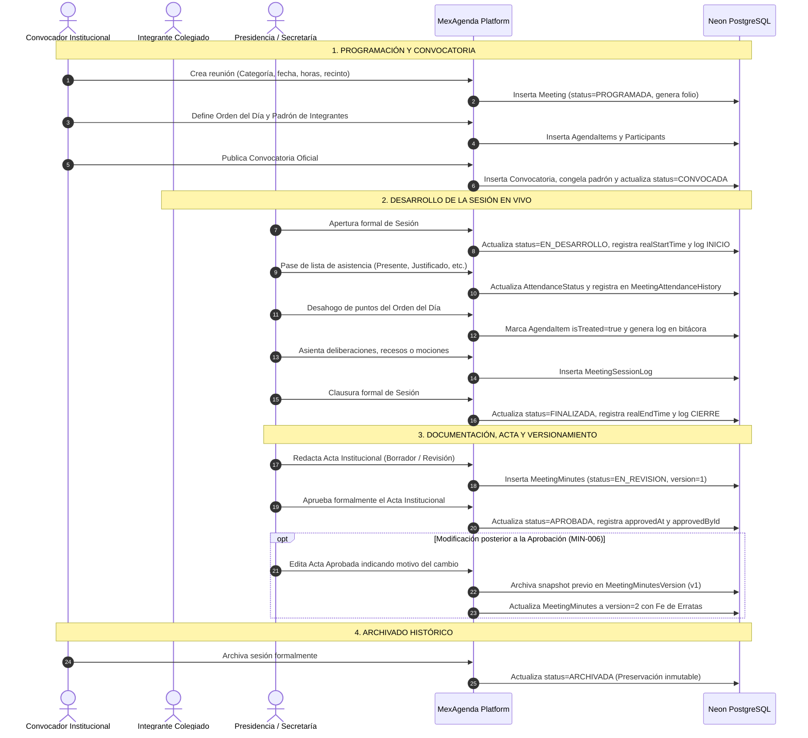

# 05 — Flujos Operativos y Procesos de Negocio Colegiado

## 1. Flujo Integral de una Sesión Colegiada

El siguiente diagrama describe el ciclo de vida completo desde la planificación de la reunión hasta la consolidación del acta aprobada y su eventual archivado en el acervo institucional:

---

## 2. Puntos Clave de Control Reglamentario

1. **Quórum y Porcentaje de Asistencia:**
   - La plataforma calcula en tiempo real el porcentaje colegiado:
     $$\text{Porcentaje} = \left(\frac{\text{Presentes} + \text{Tardanzas} + \text{Remotos}}{\text{Total Convocados}}\right) \times 100$$
   - Permite a la mesa directiva determinar la validez legal de los acuerdos antes de dar apertura.

2. **Cédula Notificatoria Inalterable:**
   - Una vez publicada la convocatoria, el texto de la notificación y el listado de personas destinatarias quedan sellados. Cualquier ajuste de fecha posterior requiere una circular o adenda registrada en las observaciones de la sesión.

3. **Bitácora Inmutable en Vivo:**
   - Durante la sesión, la secretaría asienta los sucesos relevantes. Las entradas en `MeetingSessionLog` no permiten edición física ni eliminación, conformando el testimonio fidedigno de lo acontecido para la elaboración posterior del acta.

4. **Versionamiento Histórico de Actas (MIN-006):**
   - Una vez aprobada un acta, cualquier corrección de estilo, aclaración de voto o fe de erratas crea obligatoriamente un registro histórico inmutable en `meeting_minutes_versions`. El expediente conserva siempre el documento original aprobado y la traza de versiones con el usuario responsable y la justificación institucional.

