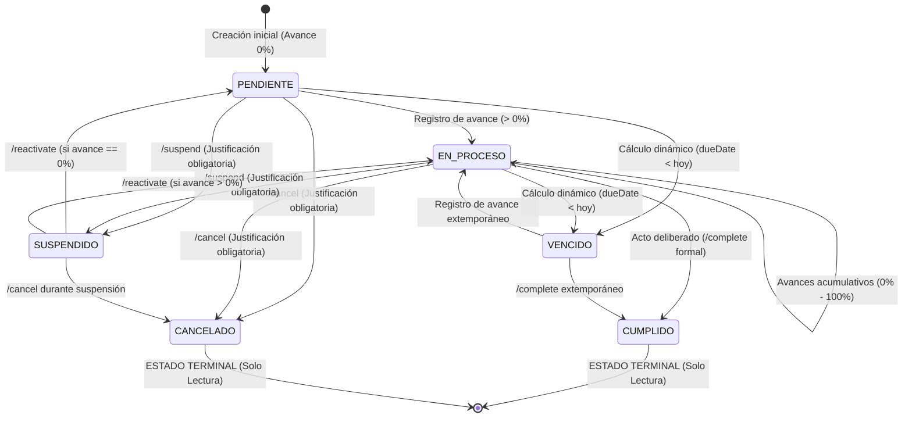

# 04. AUDITORÍA DE LA MÁQUINA DE ESTADOS FINITA (MOD-03)
## MexAgenda — Sistema Privado de Gestión Institucional

### 1. Modelo Determinista de Estados Institucionales

La auditoría de la máquina de estados comprobó empíricamente que el ciclo de vida de los acuerdos está gobernado por reglas deterministas implementadas en el backend que impiden saltos de estado anómalos o incongruencias operativas.

---

### 2. Comprobación Empírica de Transiciones y Restricciones

A través de la suite automatizada `scripts/test-phase4-audit.js`, se verificaron los siguientes comportamientos:

#### 2.1. Transición Automática a `EN_PROCESO` (`FSM-01`)
- **Estado Inicial:** `PENDIENTE` con `progressPercent = 0`.
- **Acción:** Registro de primer avance con `newPercent = 25`.
- **Resultado en Base de Datos:** El estado cambia automáticamente a `EN_PROCESO`.
- **Dictamen:** **APROBADO.**

#### 2.2. Verificación de la "Regla de Oro" Institucional (`FSM-02`)
- **Condición:** Registro de un avance que eleva el progreso al `100%`.
- **Comportamiento Verificado:** El campo `progressPercent` se actualiza a 100, pero el campo `status` **PERMANECE EN `EN_PROCESO`**.
- **Fundamento Institucional:** Un servidor público responsable no puede auto-declarar formalmente cumplido un mandato emanado del órgano colegiado; el cumplimiento requiere un acto formal de fiscalización y certificación por la autoridad facultada.
- **Dictamen:** **APROBADO. La Regla de Oro funciona fielmente.**

#### 2.3. Exigencia de Fundamentación Obligatoria en Suspensiones (`FSM-03` y `FSM-04`)
- **Intento sin Justificación:** Se envía `POST /agreements/:id/suspend` con justificación vacía (`"   "`).
- **Respuesta:** Rechazo inmediato con `HTTP 400 Bad Request` indicando que la justificación es obligatoria.
- **Intento con Justificación Válida:** Se proporciona motivación fundada. El estado transmuta a `SUSPENDIDO`.
- **Dictamen:** **APROBADO.**

#### 2.4. Bloqueo Estricto de Avances durante Suspensión (`FSM-05`)
- **Acción:** Se intenta registrar un avance sobre el acuerdo en estado `SUSPENDIDO`.
- **Resultado:** Rechazado con `HTTP 400 Bad Request` (`"No es posible asentar avances en un acuerdo en estado [SUSPENDIDO]"`).
- **Dictamen:** **APROBADO. Impide alterar plazos en acuerdos pausados.**

#### 2.5. Reactivación Inteligente y Coherente (`FSM-06`)
- **Acción:** Se invoca `POST /agreements/:id/reactivate` sobre el acuerdo suspendido.
- **Lógica de Negocio Verificada:**  
  - Como el acuerdo contaba con avance previo (`progressPercent > 0`), el sistema lo reactivó al estado `EN_PROCESO`.
  - Se verificó que si el avance hubiera sido 0%, retornaría a `PENDIENTE`.
- **Dictamen:** **APROBADO.**

#### 2.6. Formalización Deliberada de Cumplimiento (`FSM-07`)
- **Acción:** Autoridad institucional invoca `POST /agreements/:id/complete` registrando notas formales de resolución.
- **Efecto:** El acuerdo pasa a `CUMPLIDO`, fija `progressPercent = 100`, sella `completionDate` y registra el evento formal en el histórico y en la bitácora central de seguridad.
- **Dictamen:** **APROBADO.**

#### 2.7. Inviolabilidad de Estados Terminales (`FSM-08`)
- **Acción:** Se intenta registrar un avance o modificar un acuerdo en estado `CUMPLIDO` o `CANCELADO`.
- **Respuesta:** El backend rechaza la transacción con `HTTP 400 Bad Request`.
- **Dictamen:** **APROBADO. Los acuerdos concluidos son sellados e inmutables.**

---

### 3. Semáforo Dinámico y Cálculo de Vencimientos (`CONCURR-03`)

- **Problema Auditado:** Riesgo de contradicción entre el estado almacenado en disco y la fecha actual del sistema (ej. un acuerdo almacenado como `EN_PROCESO` cuya fecha límite expiró ayer).
- **Implementación Auditada:** El método `calculateEffectiveStatus(storedStatus, dueDate)` evalúa en tiempo real si `dueDate < hoy`:
  - Si el estado no es terminal (`CUMPLIDO`, `CANCELADO`) ni `SUSPENDIDO`, el estado devuelto al cliente y en reportes es dinámicamente `VENCIDO`.
  - Las horas se normalizan con `setUTCHours(0, 0, 0, 0)` evitando falsos vencimientos por desfase de zona horaria entre el servidor y el cliente.
- **Dictamen:** **CONFORME. Cero contradicciones temporales detectadas.**

