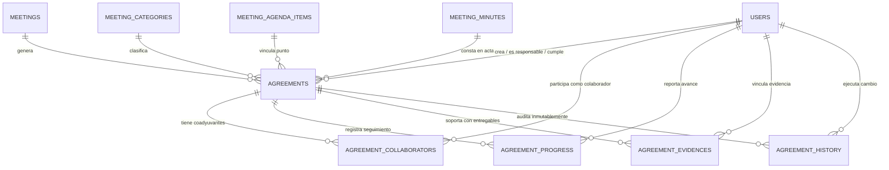

# 02. MODELO DE DATOS Y PERSISTENCIA EN NEON POSTGRESQL (MOD-03)
## MexAgenda — Sistema Privado de Gestión Institucional

### 1. Diagrama Entidad-Relación de Acuerdos Institucionales



### 2. Tablas Principales del Módulo

#### 2.1. Tabla `agreements`
Almacena el registro principal del acuerdo institucional colegiado.

| Columna | Tipo de Dato | Restricción | Descripción |
| :--- | :--- | :--- | :--- |
| `id` | UUID | PRIMARY KEY | Identificador universal único. |
| `folio` | VARCHAR(60) | UNIQUE, NOT NULL | Folio institucional (`ACU-PRE-2026-001`). |
| `title` | VARCHAR(255) | NOT NULL | Síntesis ejecutiva del acuerdo colegiado. |
| `description` | TEXT | NOT NULL | Mandato, alcances y condiciones institucionales. |
| `agreement_type` | VARCHAR(50) | NOT NULL | Tipo (`ACUERDO_ORDINARIO`, etc.). |
| `meeting_id` | UUID | NOT NULL, FK | Referencia a la reunión colegiada de origen. |
| `category_id` | UUID | NULLABLE, FK | Taxonomía heredada o específica. |
| `agenda_item_id` | UUID | NULLABLE, FK | Punto deliberado del orden del día. |
| `minutes_id` | UUID | NULLABLE, FK | Acta formal en que consta el acuerdo. |
| `minutes_version_number` | INT | NULLABLE | Versión del acta al momento de la vinculación. |
| `approval_date` | TIMESTAMPTZ | NOT NULL | Fecha formal de adopción colegiada. |
| `start_date` | TIMESTAMPTZ | NULLABLE | Fecha de inicio de labores operativas. |
| `due_date` | TIMESTAMPTZ | NOT NULL | Fecha límite fatal de cumplimiento. |
| `completion_date` | TIMESTAMPTZ | NULLABLE | Fecha formal de certificación de cumplimiento. |
| `priority` | ENUM | NOT NULL | `BAJA`, `MEDIA`, `ALTA`, `URGENTE`. |
| `status` | ENUM | NOT NULL | `PENDIENTE`, `EN_PROCESO`, `CUMPLIDO`, `VENCIDO`, `SUSPENDIDO`, `CANCELADO`. |
| `progress_percent` | INT | NOT NULL, DEFAULT 0 | Porcentaje de avance acumulativo (0 a 100). |
| `observations` | TEXT | NULLABLE | Observaciones o instrucciones complementarias. |
| `change_reason` | TEXT | NULLABLE | Justificación de la última alteración formal. |
| `created_by_id` | UUID | NOT NULL, FK | Servidor que registró inicialmente el acuerdo. |
| `assigned_to_id` | UUID | NOT NULL, FK | Servidor público responsable principal. |
| `completed_by_id` | UUID | NULLABLE, FK | Servidor facultado que declaró el cumplimiento. |
| `version` | INT | NOT NULL, DEFAULT 1 | Número de versión para bloqueo optimista. |
| `is_archived` | BOOLEAN | NOT NULL, DEFAULT false | Marcaje de baja lógica del padrón activo. |
| `created_at` | TIMESTAMPTZ | NOT NULL, DEFAULT now() | Estampa cronológica de creación. |
| `updated_at` | TIMESTAMPTZ | NOT NULL | Estampa cronológica de última modificación. |
| `deleted_at` | TIMESTAMPTZ | NULLABLE | Fecha de baja lógica institucional. |

#### 2.2. Tabla `agreement_collaborators`
Gestiona servidores y miembros coadyuvantes en la ejecución del acuerdo.

| Columna | Tipo de Dato | Restricción | Descripción |
| :--- | :--- | :--- | :--- |
| `id` | UUID | PRIMARY KEY | Identificador único del registro de colaboración. |
| `agreement_id` | UUID | NOT NULL, FK | Acuerdo institucional vinculado. |
| `user_id` | UUID | NOT NULL, FK | Servidor o miembro coadyuvante. |
| `assigned_by_id` | UUID | NOT NULL, FK | Servidor que designó la coadyuvancia. |
| `assigned_at` | TIMESTAMPTZ | NOT NULL, DEFAULT now() | Fecha y hora de asignación. |
| `notes` | VARCHAR(255) | NULLABLE | Funciones asignadas o rol de apoyo. |

*Índice Único:* `@@unique([agreement_id, user_id])` — impide que un usuario sea asignado dos veces como colaborador en el mismo acuerdo.

#### 2.3. Tabla `agreement_progress`
Bitácora acumulativa de avances porcentuales y cualitativos reportados.

| Columna | Tipo de Dato | Restricción | Descripción |
| :--- | :--- | :--- | :--- |
| `id` | UUID | PRIMARY KEY | Identificador único del avance. |
| `agreement_id` | UUID | NOT NULL, FK | Acuerdo reportado. |
| `reported_by_id` | UUID | NOT NULL, FK | Servidor que rinde el informe de avance. |
| `reported_at` | TIMESTAMPTZ | NOT NULL, DEFAULT now() | Estampa cronológica de reporte. |
| `previous_percent` | INT | NOT NULL | Porcentaje antes del reporte (0 a 100). |
| `new_percent` | INT | NOT NULL | Porcentaje resultante alcanzado (0 a 100). |
| `description` | TEXT | NOT NULL | Resumen detallado de actividades y logros. |
| `observations` | TEXT | NULLABLE | Observaciones o condicionantes técnicas. |
| `resulting_status` | ENUM | NULLABLE | Estado institucional sugerido tras el avance. |
| `justification` | TEXT | NULLABLE | Justificación obligatoria en caso de reducción. |

#### 2.4. Tabla `agreement_evidences`
Soporte documental y referencias de entregables.

| Columna | Tipo de Dato | Restricción | Descripción |
| :--- | :--- | :--- | :--- |
| `id` | UUID | PRIMARY KEY | Identificador de la evidencia documental. |
| `agreement_id` | UUID | NOT NULL, FK | Acuerdo institucional sustentado. |
| `progress_id` | UUID | NULLABLE, FK | Avance específico al que se asocia la evidencia. |
| `title` | VARCHAR(200) | NOT NULL | Título institucional del entregable o documento. |
| `description` | TEXT | NULLABLE | Resumen de contenido o acreditación legal. |
| `document_reference` | VARCHAR(500) | NULLABLE | Folio de oficio, referencia física o clave de bóveda. |
| `registered_by_id` | UUID | NOT NULL, FK | Servidor que adjuntó la referencia. |
| `created_at` | TIMESTAMPTZ | NOT NULL, DEFAULT now() | Estampa de vinculación. |

#### 2.5. Tabla `agreement_history`
Bitácora inmutable append-only con preservación de estados y motivos.

| Columna | Tipo de Dato | Restricción | Descripción |
| :--- | :--- | :--- | :--- |
| `id` | UUID | PRIMARY KEY | Identificador único del evento histórico. |
| `agreement_id` | UUID | NOT NULL, FK | Acuerdo auditado. |
| `action_type` | VARCHAR(60) | NOT NULL | Tipo de acción (`CREATION`, `REASSIGNMENT`, `PROGRESS_UPDATE`, `COMPLETION_CONFIRMED`, `SUSPENSION`, `REACTIVATION`, `CANCELLATION`). |
| `previous_status` | ENUM | NULLABLE | Estado anterior a la transición. |
| `new_status` | ENUM | NULLABLE | Estado resultante de la transición. |
| `previous_assigned_to_id` | UUID | NULLABLE, FK | Responsable anterior en reasignaciones. |
| `new_assigned_to_id` | UUID | NULLABLE, FK | Nuevo responsable asignado. |
| `previous_due_date` | TIMESTAMPTZ | NULLABLE | Fecha límite previa en caso de prórroga. |
| `new_due_date` | TIMESTAMPTZ | NULLABLE | Nueva fecha límite formal. |
| `previous_percent` | INT | NULLABLE | Avance previo en caso de reporte. |
| `new_percent` | INT | NULLABLE | Nuevo avance reportado. |
| `progress_notes` | TEXT | NULLABLE | Notas asociadas al evento. |
| `change_reason` | TEXT | NULLABLE | Justificación o fundamentación institucional. |
| `details` | JSONB | NULLABLE | Metadatos técnicos estructurados del cambio. |
| `changed_by_id` | UUID | NOT NULL, FK | Servidor autorizante que ejecutó la acción. |
| `created_at` | TIMESTAMPTZ | NOT NULL, DEFAULT now() | Estampa cronológica inmutable. |

### 3. Índices de Rendimiento en Neon PostgreSQL

```sql
-- Consultas y unicidad de Folio
CREATE UNIQUE INDEX "agreements_folio_key" ON "agreements"("folio");
CREATE INDEX "agreements_meeting_id_idx" ON "agreements"("meeting_id");
CREATE INDEX "agreements_assigned_to_id_idx" ON "agreements"("assigned_to_id");
CREATE INDEX "agreements_status_idx" ON "agreements"("status");
CREATE INDEX "agreements_due_date_idx" ON "agreements"("due_date");

-- Colaboradores
CREATE UNIQUE INDEX "agreement_collaborators_agreement_id_user_id_key" ON "agreement_collaborators"("agreement_id", "user_id");

-- Avances y Línea de Tiempo
CREATE INDEX "agreement_progress_agreement_id_reported_at_idx" ON "agreement_progress"("agreement_id", "reported_at");

-- Historial Inmutable
CREATE INDEX "agreement_history_agreement_id_created_at_idx" ON "agreement_history"("agreement_id", "created_at");
```

