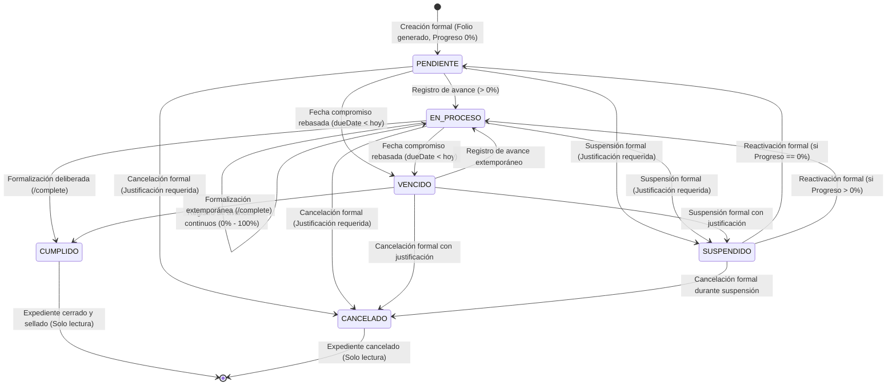

# 06. MÁQUINA DE ESTADOS FINITA DE ACUERDOS (MOD-03)
## MexAgenda — Sistema Privado de Gestión Institucional

### 1. Definición Formal de Estados Institucionales

El ciclo de vida de todo acuerdo en MexAgenda está gobernado por una **Máquina de Estados Finita Determinista (FSM)** que previene inconsistencias operativas y garantiza que ningún acuerdo transicione sin la debida justificación o permiso institucional.

| Estado | Tipo | Descripción Operativa |
| :--- | :--- | :--- |
| `PENDIENTE` | Inicial | Acuerdo creado formalmente. Aún no se han reportado avances de cumplimiento (`currentProgress == 0`). |
| `EN_PROCESO` | Activo | El responsable o colaboradores han iniciado la ejecución y reportado avances (`0% < currentProgress <= 100%`). |
| `CUMPLIDO` | Terminal | Certificación de cumplimiento formal aprobada deliberadamente por autoridad competente mediante `/complete`. |
| `VENCIDO` | Dinámico / Activo | Acuerdo activo no concluido cuya fecha compromiso (`dueDate`) es anterior a la fecha actual (`dueDate < hoy`). |
| `SUSPENDIDO` | Intermedio | Ejecución pausada temporalmente por causas de fuerza mayor o veda presupuestal con fundamentación obligatoria. |
| `CANCELADO` | Terminal | Acuerdo revocado o cancelado formalmente por pérdida de materia o resolución del pleno. |

---

### 2. Diagrama de Transición de Estados

---

### 3. Matriz de Transiciones Permitidas

| Estado Origen | `PENDIENTE` | `EN_PROCESO` | `CUMPLIDO` | `VENCIDO` | `SUSPENDIDO` | `CANCELADO` |
| :--- | :---: | :---: | :---: | :---: | :---: | :---: |
| **`PENDIENTE`** | — | Vía Avance (>0%) | Vía `/complete` | Dinámico (`dueDate`) | Vía `/suspend` | Vía `/cancel` |
| **`EN_PROCESO`** | No | Avance sucesivo | Vía `/complete` | Dinámico (`dueDate`) | Vía `/suspend` | Vía `/cancel` |
| **`CUMPLIDO`** | **PROHIBIDO** | **PROHIBIDO** | — | **PROHIBIDO** | **PROHIBIDO** | **PROHIBIDO** |
| **`VENCIDO`** | No | Vía Avance | Vía `/complete` | — | Vía `/suspend` | Vía `/cancel` |
| **`SUSPENDIDO`** | Vía Reactivar (si 0%) | Vía Reactivar (si >0%) | No | No | — | Vía `/cancel` |
| **`CANCELADO`** | **PROHIBIDO** | **PROHIBIDO** | **PROHIBIDO** | **PROHIBIDO** | **PROHIBIDO** | — |

---

### 4. Reglas de Invarianza y Condiciones de Rechazo

1. **Inviolabilidad de Estados Terminales (`CUMPLIDO` y `CANCELADO`):**  
   Una vez que un acuerdo alcanza los estados `CUMPLIDO` o `CANCELADO`, cualquier intento de mutación (actualización general, asignación, registro de avances, suspensiones o cancelación duplicada) es rechazado inmediatamente por el backend con un error `400 Bad Request` indicando:
   `"No es posible modificar un acuerdo en estado CUMPLIDO o CANCELADO"`.

2. **La Regla de Oro Institucional (El 100% no es Cumplido):**  
   Cuando un responsable registra un avance que sitúa el campo `currentProgress` en 100%, el acuerdo **NO** pasa de forma automática a `CUMPLIDO`. Permanece en `EN_PROCESO` hasta que la autoridad facultada invoca expresamente el endpoint `POST /agreements/:id/complete` registrando el acta de cierre o notas de resolución.

3. **Reactivación Exclusiva de Acuerdos Suspendidos:**  
   El endpoint `/agreements/:id/reactivate` arroja error si se ejecuta sobre acuerdos que no se encuentren en estado `SUSPENDIDO`. Al reactivar, el sistema evalúa el progreso previo:
   - Si `currentProgress === 0`, el estado asignado es `PENDIENTE`.
   - Si `currentProgress > 0`, el estado asignado es `EN_PROCESO`.

4. **Semáforo Dinámico de Vencimiento:**  
   El estado `VENCIDO` se evalúa dinámicamente en el backend al consultar el acuerdo o en las rutinas de listado:
   - Si `status` es `PENDIENTE` o `EN_PROCESO` y la fecha actual es posterior a `dueDate` a las 23:59:59 horas, se computa como vencido.
   - En listados y reportes, la consulta SQL/Prisma filtra mediante cláusulas condicionales asegurando que los acuerdos con plazo vencido aparezcan agrupados en el semáforo de alerta roja institucional.

5. **Exigencia de Fundamentación Textual Indeleble:**  
   Toda transición que implique una suspensión temporal (`/suspend`), cancelación definitiva (`/cancel`) o decremento porcentual exige un argumento formal no menor a 5 caracteres. Los espacios en blanco o valores nulos provocan el rechazo automático de la petición.

