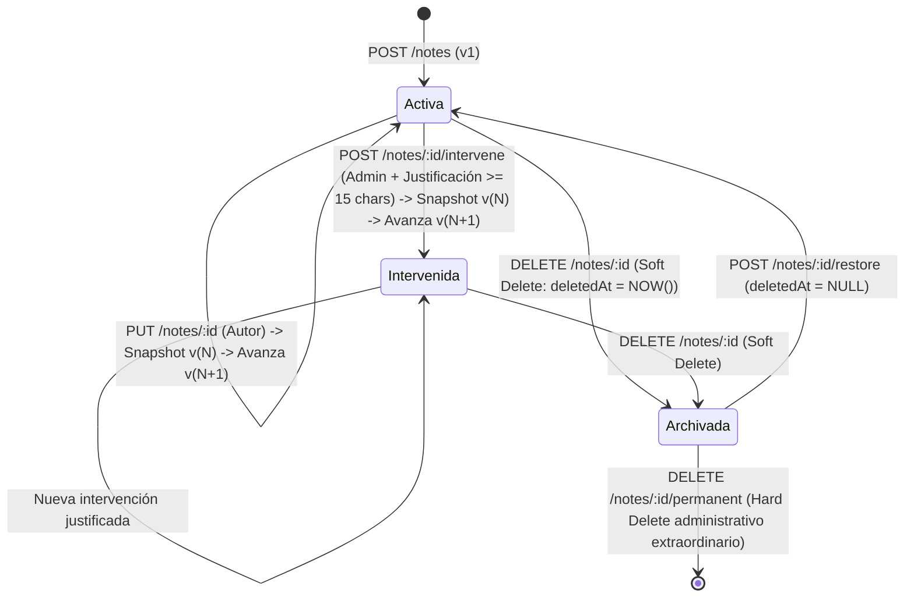

# ARQUITECTURA Y ESPECIFICACIÓN TÉCNICA — MOD-04
## Módulo de Anotaciones Personales y Notas de Sesión

### 1. INTRODUCCIÓN Y PRINCIPIOS DE DISEÑO

El módulo **MOD-04** ha sido estructurado siguiendo los lineamientos de arquitectura empresarial de MexAgenda: diseño orientado al dominio (DDD), desacoplamiento estricto por capas, soberanía de la información, inmutabilidad de la auditoría y apego riguroso al principio de menor privilegio.

```
+-----------------------------------------------------------------------------------+
|                        CAPA DE PRESENTACIÓN (Next.js 15)                          |
|  - /notes (Catálogo con pestañas: Mis notas, Sesión, Favoritas, Papelera)         |
|  - /notes/new (Formulario de redacción y vinculación con reuniones/acuerdos)      |
|  - /notes/[id] (Expediente, historial de versiones, edición e intervención)       |
+------------------------------------------+----------------------------------------+
                                           | HTTP / Cookies seguras (__Host-session)
                                           v
+-----------------------------------------------------------------------------------+
|                        CAPA DE APLICACIÓN Y API (NestJS 11)                       |
|  - NotesController: Endpoints REST seguros con @RequirePermissions y @UseGuards    |
|  - NotesService: Lógica de negocio, Anti-IDOR, aislamiento y control de versiones|
|  - DTOs & Validation: class-validator + class-transformer (RFC 7807)               |
|  - AuditService: Trazabilidad forense inmutable de eventos NOTE_*                 |
+------------------------------------------+----------------------------------------+
                                           | Prisma ORM 6.19.3
                                           v
+-----------------------------------------------------------------------------------+
|                      CAPA DE PERSISTENCIA (Neon PostgreSQL)                       |
|  - personal_notes: Entidad principal de anotaciones y metadatos                   |
|  - personal_note_versions: Histórico append-only de snapshots inmutables          |
|  - audit_logs: Bitácora centralizada de eventos del sistema institucional         |
+-----------------------------------------------------------------------------------+
```

---

### 2. PILARES ARQUITECTÓNICOS DEL MÓDULO

#### A. Aislamiento Soberano y Protección Anti-IDOR / Anti-BOLA
A diferencia de las actas colegiadas y convocatorias (que son documentos institucionales de acceso colegiado), las anotaciones son por definición **privadas del autor institucional** a menos que se les asigne explícitamente visibilidad de reunión o pública.
1. **Inyección de Autoría:** La autoría (`authorId`) no se recibe en el cuerpo de la petición; es extraída obligatoriamente de la sesión autenticada validada en el `SessionAuthGuard`.
2. **Control de Modificación:** Únicamente el autor posee facultades ordinarias de actualización (`PUT /notes/:id`). Cualquier intento de modificación de nota ajena es bloqueado con código HTTP `403 Forbidden` y genera un evento de auditoría `UNAUTHORIZED_NOTE_MUTATION_ATTEMPT` con resultado `DENIED`.
3. **Control de Baja:** El archivado (`DELETE /notes/:id`) solo puede ser ejecutado por el autor o por un administrador con credenciales de auditoría.

#### B. Protocolo de Intervención Administrativa Extraordinaria
En casos de fuerza mayor institucional, auditoría judicial o requerimiento del Órgano Interno de Control, un administrador institucional puede requerir la intervención de una nota. Dicha acción sigue un protocolo estrictamente auditado:
- Endpoint específico: `POST /notes/:id/intervene`.
- Permiso obligatorio: `note:override_any`.
- Justificación legal obligatoria: Campo `adminJustification` con longitud mínima de 15 caracteres explicativos.
- Snapshot previo automático: Se preserva la versión anterior intacta en `personal_note_versions` con el indicador `isAdminIntervention = true`.
- Marca indeleble: El registro se etiqueta con `isAdminModified = true`, almacenando `lastAdminIntervenorId` y la justificación.
- Auditoría de Máxima Criticidad: Se asienta en `audit_logs` con acción `NOTE_ADMIN_OVERRIDE` y severidad `CRITICAL`.

#### C. Inviolabilidad de Actas Institucionales
Las notas de sesión vinculadas a una reunión (`meetingId`) o acuerdo (`agreementId`) son documentos de análisis y deliberación. No sustituyen el quórum, no modifican las firmas del acta y no alteran la tabla `meeting_minutes` bajo ninguna circunstancia.

---

### 3. DIAGRAMA DE FLUJO: CICLO DE VIDA DE UNA ANOTACIÓN



---

### 4. CONTRATOS Y TIPADO EN `@mexagenda/shared`

El paquete compartido `@mexagenda/shared` centraliza los enums y contratos utilizados de extremo a extremo:
- `NoteCategory`: `GENERAL`, `JURIDICO`, `TECNICO`, `PRESUPUESTAL`, `ACUERDO`, `SESION`, `SEGUIMIENTO`.
- `NoteType`: `PERSONAL`, `SESION`, `OBSERVACION`, `PENDIENTE`.
- `NoteVisibility`: `PRIVADA`, `REUNION`, `PUBLICA`.
- DTOs e interfaces de transferencia: `PersonalNoteListItem`, `PersonalNoteDetailDto`, `PersonalNoteVersionDto`, `CreatePersonalNoteDto`, `UpdatePersonalNoteDto`, `AdminInterveneNoteDto`, `QueryNotesDto`.

