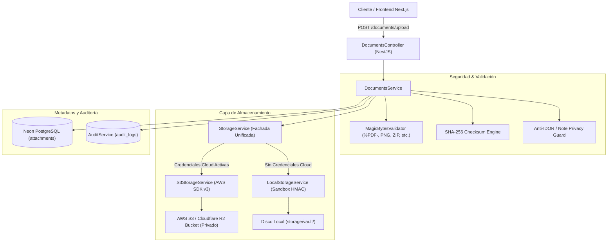

# ARQUITECTURA DEL SUBSISTEMA DE ALMACENAMIENTO — FASE 6
## MEXAGENDA: BÓVEDA DIGITAL Y GESTIÓN DOCUMENTAL (MOD-05)

### 1. PRINCIPIOS DE DISEÑO ARQUITECTÓNICO

El subsistema de almacenamiento de MexAgenda fue diseñado bajo las siguientes premisas fundamentales:

1. **Aislamiento Criptográfico y Privacidad por Defecto:**
   - El almacenamiento de objetos es **100% privado**. No existen permisos de lectura pública (`public-read`).
   - Ningún archivo puede ser accedido de forma directa o pública a través de URLs estáticas.
   - Todo acceso pasa por validación previa de sesión y permisos en el backend de NestJS.
2. **Abstracción Agnostica del Proveedor (`StorageDriver`):**
   - El núcleo de negocio interactúa exclusivamente con la interfaz `StorageDriver`, desacoplando la lógica de negocio del proveedor cloud subyacente.
3. **Estrategia Dual Cloud / Sandbox:**
   - **Modo Producción / Staging:** Compatible con cualquier almacenamiento de objetos S3 estándar (AWS S3, Cloudflare R2, MinIO, GCP Cloud Storage) mediante `@aws-sdk/client-s3` y `@aws-sdk/s3-request-presigner`.
   - **Modo Local / CI-CD Sandbox:** Driver local en disco (`LocalStorageService`) con firmas temporales HMAC-SHA256, permitiendo ejecutar suites completas de pruebas automatizadas y desarrollo sin depender de infraestructura externa.
4. **Partición Temporal de Claves:**
   - Estructura de claves de almacenamiento: `vault/{yyyy}/{mm}/{uuidv4()}-{sanitizedFilename}`.
   - Evita colisiones de nombres, previene sobreescrituras accidentales y elimina vulnerabilidades de *Path Traversal*.

---

### 2. DIAGRAMA ARQUITECTÓNICO DEL SUBSISTEMA



---

### 3. CONTRATO DE LA INTERFAZ `StorageDriver`

```typescript
export interface UploadFileOptions {
  key: string;
  buffer: Buffer;
  mimeType: string;
  originalFilename: string;
  metadata?: Record<string, string>;
}

export interface StorageDriver {
  upload(options: UploadFileOptions): Promise<{ storageKey: string; locationUrl?: string }>;
  getDownloadPresignedUrl(key: string, originalFilename: string, expiresInSeconds: number): Promise<string>;
  delete(key: string): Promise<void>;
  exists(key: string): Promise<boolean>;
  getFileBuffer(key: string): Promise<Buffer>;
}
```

---

### 4. GESTIÓN DE TIEMPO DE VIDA (TTL) Y PRESIGNED URLS

- **Tiempo de Expiración:** 300 segundos (5 minutos exactos).
- **Cabecera `Content-Disposition` Forzada:**
  Tanto en S3 como en el Sandbox local, la URL presignada incorpora la directiva forzada:
  ```http
  Content-Disposition: attachment; filename="documento_sanitizado.pdf"
  ```
  Esto previene que archivos potencialmente peligrosos (como SVG o HTML) se ejecuten en el contexto de navegación del navegador (protección contra XSS almacenado).
- **Anti-Tampering:** En el Sandbox local, las URLs se firman criptográficamente mediante HMAC-SHA256:
  ```
  signature = HMAC-SHA256(key + ":" + expiresAt + ":" + originalFilename, SESSION_SECRET)
  ```
  Cualquier alteración en la clave, fecha de expiración o nombre invalida inmediatamente la solicitud con código `403 Forbidden`.

