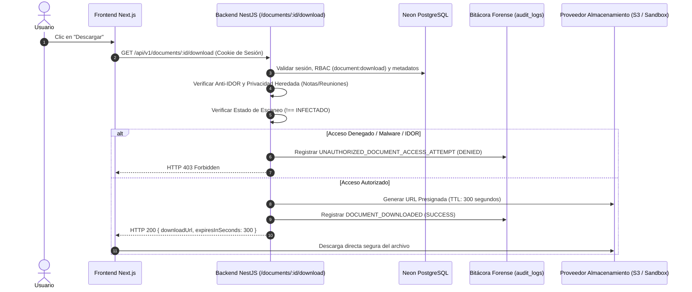

# SEGURIDAD EN DESCARGAS Y CONTROL DE PERMISOS — FASE 6
## MEXAGENDA: BÓVEDA DIGITAL Y GESTIÓN DOCUMENTAL (MOD-05)

### 1. MODELO DE DESCARGA SEGURA

En MexAgenda, los archivos almacenados en la bóveda digital **nunca se exponen mediante enlaces permanentes ni rutas públicas**.

El proceso de descarga sigue un flujo de tres capas:



---

### 2. AISLAMIENTO ANTI-IDOR / ANTI-BOLA Y PRIVACIDAD HEREDADA

#### 2.1 Herencia de Privacidad de Anotaciones Personales (MOD-04)
Si un documento fue cargado y vinculado a una nota personal (`personalNoteId != null`):
- Se consulta el registro de la nota vinculada.
- Si la nota tiene visibilidad `PRIVADA`:
  * **Solo el autor legítimo de la nota** (`personalNote.authorId === user.id`) o un usuario con rol de supervisión administrativa (`ROLE_ADMIN`) puede generar el enlace de descarga o visualizar metadatos en la ficha técnica.
  * Cualquier otro usuario autenticado recibe un error inmediato **HTTP 403 Forbidden**:
    > *"Acceso denegado: este archivo pertenece a una anotación privada institucional."*
  * Se genera de forma automática un registro forense en `audit_logs` con acción `UNAUTHORIZED_DOCUMENT_ACCESS_ATTEMPT` y resultado `DENIED`.

#### 2.2 Cuarentena y Bloqueo de Malware
Si un archivo ha sido catalogado por el área de ciberseguridad con estado de escaneo `scanStatus = 'INFECTADO'`:
- La descarga queda **estrictamente bloqueada** para todos los usuarios ordinarios (`ROLE_USER`).
- Únicamente los administradores con permiso `document:admin:manage` pueden auditar o descargar el archivo para fines de análisis forense en sandbox.

---

### 3. MECANISMO DE URLS PRESIGNADAS (AWS S3 & SANDBOX)

#### 3.1 Integración Nativa con AWS S3 / Cloudflare R2
Utiliza la instrucción oficial `GetObjectCommand` y `getSignedUrl` de `@aws-sdk/s3-request-presigner`:
```typescript
const command = new GetObjectCommand({
  Bucket: this.bucketName,
  Key: key,
  ResponseContentDisposition: `attachment; filename="${encodeURIComponent(sanitizedFilename)}"`,
});

return await getSignedUrl(this.s3Client, command, {
  expiresIn: 300, // 5 minutos
});
```

#### 3.2 Implementación Sandbox Local (HMAC-SHA256 Anti-Tampering)
En entornos locales y suites de pruebas sin bucket S3 activo:
```typescript
const expiresAt = Math.floor(Date.now() / 1000) + 300;
const dataToSign = `${key}:${expiresAt}:${originalFilename}`;
const signature = crypto
  .createHmac('sha256', this.secretKey)
  .update(dataToSign)
  .digest('hex');

return `${this.backendUrl}/api/v1/documents/local-download?key=${encodeURIComponent(key)}&expires=${expiresAt}&filename=${encodeURIComponent(originalFilename)}&sig=${signature}`;
```
Al invocar `/documents/local-download`, el servidor valida:
1. Que los parámetros no hayan sido manipulados comparando el HMAC en tiempo constante (`crypto.timingSafeEqual`).
2. Que `Date.now() / 1000 <= expiresAt`. Si expiró, responde `403 Forbidden`.

